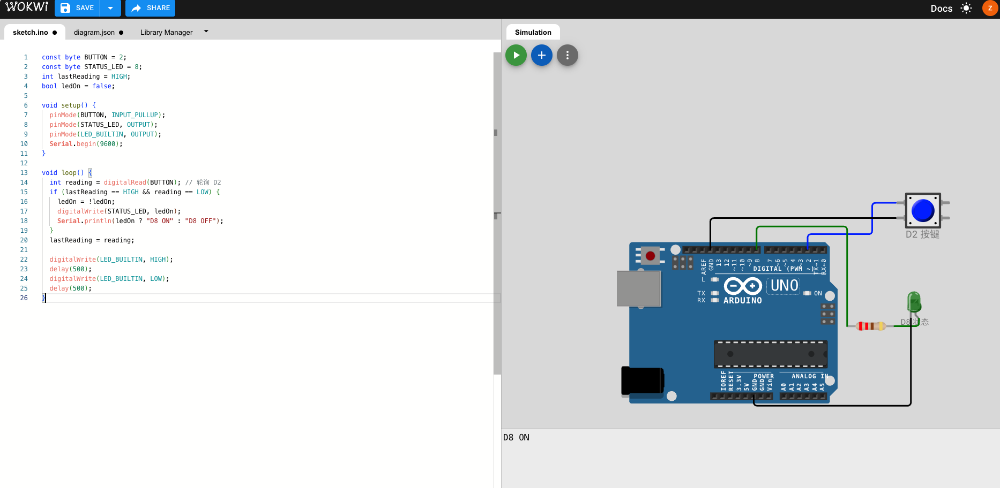
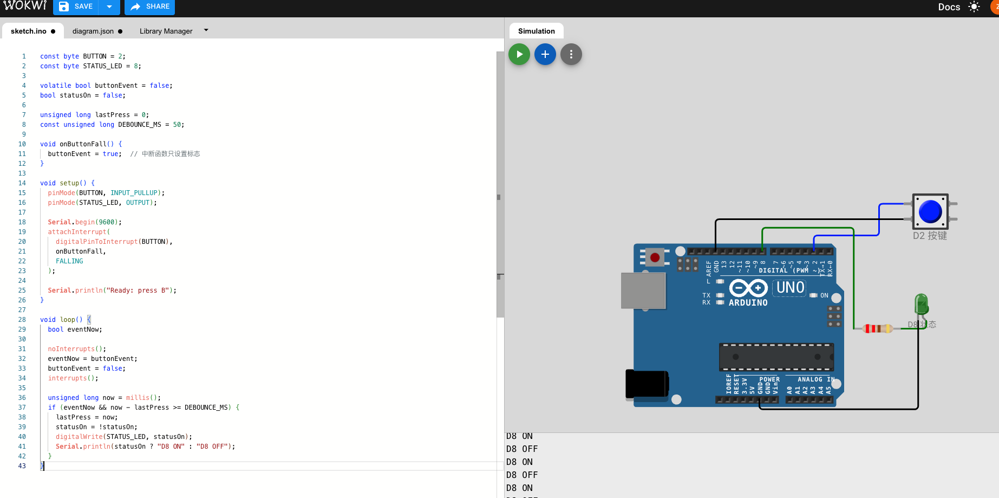
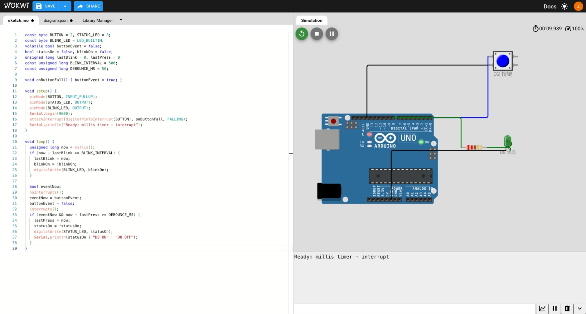
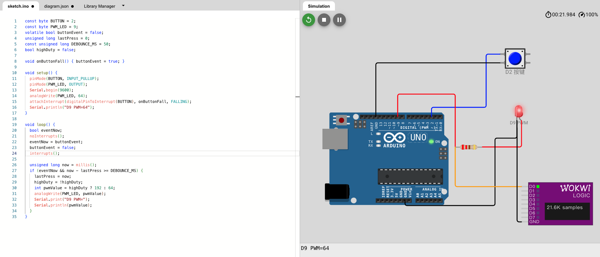
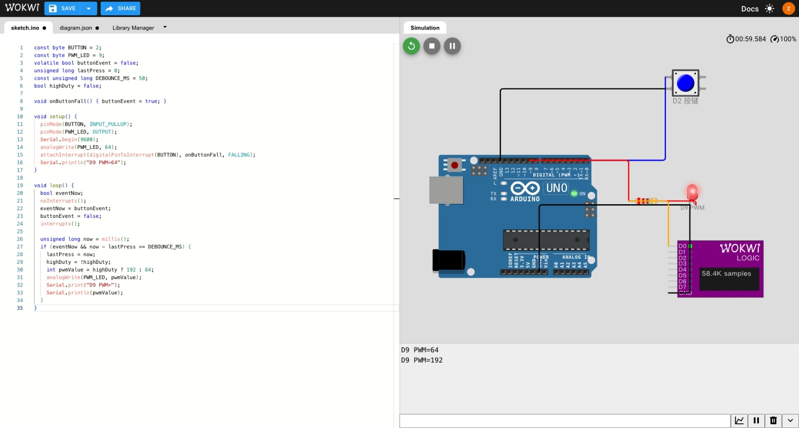
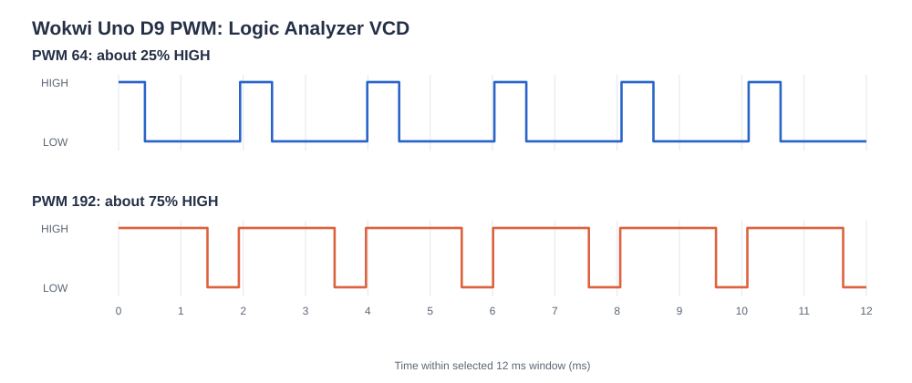

# Wokwi 单片机 GPIO、中断、定时与 PWM 一周任务书

> 适用对象：已完成 Ubuntu、C/C++ 基础和上一周 Python 开发工具训练的学生  
> 周期：1 周；建议周内 5 个晚上，每晚约 1.5～2 小时  
> 操作平台：实验室 Ubuntu 电脑的浏览器、Wokwi 在线仿真  
> 统一板卡：**Arduino Uno（ATmega328P）**；程序使用 Arduino 风格 C/C++  
> 验收方式：学生现场按检查表独立操作、记录结果；教师每周集中交流时处理共性问题

> **动手前先阅读：** [GPIO、中断、定时与 PWM 基础概念](/workshop/wokwi-gpio-interrupt-pwm-concepts/)，弄清引脚、电平、弹跳和 PWM 波形各是什么意思。

## 一、本周任务与边界

前两周已经练习 Ubuntu、C/C++、Python、OpenCV 和常用开发工具。本周转到单片机的最基本输入、输出与时间控制：让按键影响 LED，让程序在等待时间时仍能处理输入，再用 PWM 控制另一只 LED 的亮度。

本周使用 **Wokwi 仿真**，因此不需要实验室先购置或分配开发板。所有学生统一选 Arduino Uno，避免把“板卡和库的差异”误当作 GPIO 或中断原理。后续拿到真实开发板时，仍需重新验证接线、电压、电流、按键弹跳、波形和负载能力；仿真结果不能直接当作实物测试数据。

本周的“定时”必做内容是使用 `millis()` 写出**不阻塞的定时任务**。这能训练按时间安排程序工作，但**不等于已会独立配置硬件定时器寄存器**。Timer1 硬件定时中断放在提高任务，单独建项目练习。

## 二、一周结束时应有的成果

建立 `wokwi_week3/` 目录，保存下列材料：

```text
wokwi_week3/
├── README.md                 # 接线、运行方法、测试记录、自验收
├── 01_gpio_polling/
│   ├── sketch.ino
│   └── diagram.json
├── 02_button_interrupt/
│   ├── sketch.ino
│   └── diagram.json
├── 03_millis_pwm/
│   ├── sketch.ino
│   └── diagram.json
└── evidence/
    ├── pwm_64.vcd            # 逻辑分析仪导出的波形记录
    ├── pwm_192.vcd
    └── pwm_compare.png       # 两种占空比波形的对比截图
```

`diagram.json` 与 `sketch.ino` 可从 Wokwi 项目编辑器中复制到本地目录。每个阶段保留可运行版本；README 中放对应的 Wokwi 项目分享链接。若没有登录或分享功能无法使用，保存本地源码和接线文件仍是必做，不以截图代替可编辑文件。

最终现场应能独立完成：

1. 解释 `setup()`、`loop()`、`pinMode()`、`digitalRead()` 和 `digitalWrite()` 的作用。
2. 在 Uno 上让 LED 按指定周期闪烁，接入按键并读取按下状态。
3. 用 D2 的外部中断响应按键；说明轮询与中断的差别，指出中断函数为什么应尽量短。
4. 用 `millis()` 实现不阻塞的 500 ms 闪烁，同时让按键仍可响应；能说明它与 `delay(500)` 的差别。
5. 在 D9 输出两种 PWM 设置值，观察 LED 变化，并用逻辑分析仪记录高低电平波形，比较占空比。
6. 展示三个阶段的源码、接线文件和测试记录；现场修改一次闪烁周期或 PWM 设置值后重新运行。

## 三、开始前准备

- 用浏览器打开 [Wokwi](https://wokwi.com/)，新建 **Arduino Uno** 项目。先确认示例程序可启动仿真，再改动代码。
- 复习 C/C++ 中的变量、`if`、函数和无符号整数；本周程序写在 `sketch.ino` 中，不使用 Python 控制 Uno。
- 准备一个按键、两只**外接** LED、两只限流电阻和 Wokwi 的 8 通道逻辑分析仪。Uno 板载 `LED_BUILTIN` 用于闪烁练习。
- 统一引脚：**D2 接按键、D8 接按键状态 LED、D9 接 PWM LED、D13 或 `LED_BUILTIN` 接闪烁 LED**。D2 是 Uno 的外部中断引脚；D9 支持 PWM。不要把 Uno 的引脚编号直接套用到其他板卡。
- 按键采用 `INPUT_PULLUP`：D2 接按钮一侧，按钮另一侧接 GND。未按下时读取 `HIGH`，按下时读取 `LOW`。外接 LED 的支路必须串联限流电阻；仿真接线也要按实物接线规则画。

## 四、必做任务

### 任务 A：GPIO 输出与输入，先用轮询

1. 用 `LED_BUILTIN` 完成 500 ms 亮、500 ms 灭的闪烁；把周期改为 200 ms，确认现象变化。
2. 在 D2 增加按键，设置 `INPUT_PULLUP`，在 `loop()` 中用 `digitalRead(2)` 检查状态。
3. 在 D8 接一只带限流电阻的外接 LED。比较“上一次读数”与“本次读数”，只在 `HIGH → LOW` 时切换 **D8 LED** 的亮灭状态；松开后保持当前状态。板载 LED 继续用于独立闪烁，不能写成“按住才亮、松开就灭”，也不能按住期间每轮循环都切换一次。
4. 在 README 用自己的话画出或写出“D2 → 程序判断 → D8 LED”的过程，并说明为什么按下时读到 `LOW`。

第一遍可在 Wokwi 的按键属性中暂时关闭弹跳，先把基本逻辑写通。然后恢复默认弹跳，观察一次物理按下是否可能造成多次状态变化；记录现象。不要仅靠 `delay(500)` 掩盖按键问题。Wokwi 默认模拟按键触点弹跳，可以用它观察程序为何需要防抖。

**操作截图与说明：**下图是在浏览器中运行的轮询示例。左侧 `digitalRead(BUTTON)` 每次经过 `loop()` 才读取 D2；只有上次为 `HIGH`、本次为 `LOW` 时才切换 D8。右侧按键接 D2 与 GND，D8 LED 串接限流电阻；按键后 LED 点亮，串口显示 `D8 ON`。示例末尾暂时保留两次 `delay(500)` 供任务 C 对照，因此短按可能被漏读：截图中的成功响应不能证明这种写法响应及时。



**达标现象：**能展示按键状态与 LED 状态；能指出轮询代码必须不断回到读取按键的位置。

### 任务 B：外部中断与防抖观察

将上一阶段的按键处理改为外部中断，继续用 D8 LED 显示按键切换结果：

- 使用 `attachInterrupt(digitalPinToInterrupt(2), 中断函数名, FALLING)`，让“按下产生的高到低变化”触发中断。
- 用 `volatile` 修饰主程序和中断函数之间共享的标志变量。中断函数只设置标志；LED 切换、串口打印和防抖判断放在 `loop()` 中。
- 先关闭按钮弹跳，验证按一次切换一次；再打开弹跳，记录是否出现额外触发，并尝试用时间间隔过滤短时间重复触发。
- 比较轮询版与中断版：输入到达时，程序通过什么方式知道“按键发生了变化”？

中断函数中不要使用 `delay()`；`millis()` 依赖中断计时，在中断函数里也不适合用来等待时间。若使用时间间隔防抖，应在主循环处理标志时判断。

**操作截图与说明：**左侧可找到 `volatile bool buttonEvent`、只设置标志的 `onButtonFall()`，以及 `attachInterrupt(..., FALLING)`。接线方式：蓝线从 Uno **D2** 到按键一侧，黑线从按键另一侧到 **GND**；绿线从 **D8** 经 220 Ω 电阻到 LED 正极，LED 负极经黑线回到 **GND**。截图中一次点击后串口连续出现 `D8 ON`、`D8 OFF`，说明这次操作未达到“按一次只切换一次”；应记录弹跳现象，继续检查防抖条件，不能把截图当作防抖通过的证据。



**达标现象：**按键可触发 LED 状态变化；能展示 `volatile` 标志从中断函数传到主循环的过程；有一条关于弹跳现象和处理结果的记录。

### 任务 C：使用 `millis()` 实现不阻塞定时

保留 D2 按键控制 D8 LED 的功能，让**板载 LED** 每 500 ms 自动切换一次状态。程序每轮检查“当前时间减去上次切换时间是否达到 500 ms”，达到才切换并更新记录时间。使用 `unsigned long` 保存时间，不要在最终版本的主循环中用 `delay(500)` 等待。

做一个对照实验：先运行使用 `delay(500)` 的版本，再运行 `millis()` 版本。连续按键并观察响应，记录两者的差别。最后将闪烁间隔改为 200 ms，确认按键仍可响应。

**操作截图与说明：**左侧重点看 `unsigned long now = millis()` 和 `now - lastBlink >= BLINK_INTERVAL`：时间未到时程序继续向下执行，达到间隔时才翻转板载 LED，并更新 `lastBlink`。右侧仍保留 D2 按键和 D8 LED 的完整接线，便于确认定时闪烁时按键功能没有被删掉。图中 `BLINK_INTERVAL` 设为 500 ms；静态截图只能展示代码与运行状态，不能证明闪烁周期，学生还需现场观察并完成 `delay()` 对照。另附的[组合演示逻辑分析仪记录](/assets/images/wokwi/logic-demo.vcd)可供核对板载 LED 约 500 ms 的翻转间隔。



**达标现象：**LED 按设定间隔闪烁，按键操作不会因为程序等待半秒而明显失去响应；能说明“每轮检查时间”和“停在原地等待”有什么不同。

### 任务 D：PWM 输出与波形观察

将第二只外接 LED 通过限流电阻接到 **D9**，用 `analogWrite(9, 值)` 分别输出 `0`、`64`、`128`、`192`、`255`。记录 LED 亮度的主观变化，解释这些数字是 PWM 设置值，而不是直接输出的模拟电压值。

给 Wokwi 项目加入逻辑分析仪：分析仪 **D0 接 Uno D9、GND 接 Uno GND**。分别运行设置值 `64` 与 `192` 的版本，停止仿真后保存两份 `.vcd` 波形文件。在 Ubuntu 中用 PulseView 打开 VCD，截取同一时间尺度下的波形，标出哪一段是高电平、哪一段是低电平，比较两者的高电平占比。

Ubuntu 可尝试从软件仓库安装 PulseView：

```bash
sudo apt update
sudo apt install pulseview
```

打开 PulseView 后，按 Wokwi 的[逻辑分析仪指南](https://docs.wokwi.com/guides/logic-analyzer)导入 VCD。若软件仓库暂时无法安装 PulseView，先保存 VCD 和接线文件，在自验收表记录“波形查看待补”；不要仅凭程序里写了 `analogWrite()` 就勾选“已验证占空比”。

**操作截图与说明：**下面两张浏览器截图显示 D9 的初始设置值 `64`，以及点击 D2 按键后串口显示的 `192`。红线从 **D9** 经 220 Ω 电阻到 LED 正极，LED 负极接 **GND**；橙线从同一 D9 信号接分析仪 **D0**，分析仪 **GND** 也接 Uno GND。右侧红色 LED 的亮度变化只能作直观观察；要判断占空比，必须看逻辑分析仪数据。点击停止仿真后，Wokwi 会下载 VCD。另附的[组合演示原始 VCD](/assets/images/wokwi/logic-demo.vcd)中，两段高电平占比分别约为 25.1% 和 75.3%。下方对比图由该 VCD 绘制，是读波形的参考；学生仍需按本任务要求分别保存 `64` 与 `192` 的 VCD，并在 PulseView 中截取自己的同尺度波形。







**达标现象：**`64` 与 `192` 的 LED 亮度有区别；波形截图显示两者的高电平占比不同。`0` 和 `255` 分别可表现为持续低电平和持续高电平，不要求出现周期性脉冲。

### 任务 E：整理源码与复现说明

把三个阶段的 `sketch.ino`、`diagram.json` 放入对应目录，README 至少写明：

- 各阶段 Wokwi 项目链接、引脚连接表、运行方法；
- 轮询与中断的区别，以及弹跳实验观察；
- `delay()` 与 `millis()` 对按键响应的影响；
- PWM 设置值、波形截图、占空比比较；
- 至少一个自己遇到的错误，按“现象—猜测—检查—结果”记录。

使用上周学过的 Git 为“GPIO 轮询”“外部中断”“定时与 PWM”至少各留一次有意义的提交。仓库可以继续使用自己的 GitHub 账号；现场能从本地文件或仓库重新打开 Wokwi 项目并运行，才算材料完整。

**操作说明：**Wokwi 项目顶部有 `sketch.ino` 和 `diagram.json` 两个编辑页签。`diagram.json` 中的 `connections` 列表逐行写出导线的两个端点，可对照电路图核查接线。分别打开两个页签，把内容保存到本地同名文件；保存在线项目后，点击顶部 **SHARE** 可复制该阶段的项目链接，写进 README。**分享链接和截图都不能替代本地源码、接线文件、测试记录和 Git 提交**。整理时依照第二节的目录结构检查三个阶段是否齐全，再从本地文件重新复现一次。

## 五、现场自验收

学生在现场独立重新运行，不以以前录好的视频或截图代替。通过后在 README 末尾记录日期、设备、结果和待补项。

| 检查项 | 现场操作 | 结果 |
| --- | --- | --- |
| GPIO 输出 | 把 LED 闪烁间隔从 500 ms 改为 200 ms 并运行 | □ 通过　□ 待补 |
| GPIO 输入 | 说出 `INPUT_PULLUP` 下按键按下/松开时的电平 | □ 通过　□ 待补 |
| 轮询与中断 | 打开两个阶段项目，指出按键事件在哪里被发现 | □ 通过　□ 待补 |
| 中断函数 | 指出共享标志，并解释为何不在中断里 `delay()` 或大量打印 | □ 通过　□ 待补 |
| 非阻塞定时 | LED 持续闪烁时按键仍可响应；主循环不靠 `delay(500)` | □ 通过　□ 待补 |
| PWM | 将 D9 设置值从 64 改为 192，观察亮度并比较 VCD 波形 | □ 通过　□ 波形待补 |
| 文件与复现 | 展示三个阶段源码、接线文件和 README，并从文件重新运行 | □ 通过　□ 待补 |
| 过程记录 | 查看至少三次有意义的 Git 提交和一条故障记录 | □ 通过　□ 待补 |

## 六、提高任务：单独认识硬件定时器

在完成必做内容后，另建一个 **Timer1 独立项目**，了解“定时器计数—比较匹配—触发中断—切换 LED”的链条。记录预期周期与逻辑分析仪看到的周期，解释两者若不一致可能与时钟、预分频和比较值有关。

**不要把这个实验直接合并进 D9 PWM 项目。**Uno 的 D9/D10 PWM 与 Timer1 有关联，随意改 Timer1 寄存器可能影响 D9 的 PWM 输出。提高任务以理解原理和验证波形为目标，不要求本周学生掌握全部寄存器位定义。

## 七、容易混淆的地方

| 说法 | 应如何理解 |
| --- | --- |
| “按键输入是 0，所以线路坏了” | `INPUT_PULLUP` 接法中，按下读到 `LOW` 是正常现象 |
| “用了外部中断，就不用考虑弹跳” | 弹跳可能造成多次边沿，中断程序仍需观察和处理 |
| “用了 `millis()`，就会配置硬件定时器” | `millis()` 使用系统计时能力；本周必做不直接配置 Timer1 |
| “`analogWrite(9, 128)` 输出 128 V 或恒定模拟电压” | Uno D9 输出的是数字 PWM，高低电平占比随设置值变化 |
| “仿真里亮度正常，实物接线就一定安全” | 仿真不能替代限流、电流、驱动能力和真实波形测试 |

## 八、官方参考资料

- [Wokwi：Arduino Uno 引脚与仿真支持](https://docs.wokwi.com/parts/wokwi-arduino-uno)
- [Wokwi：按钮弹跳设置](https://docs.wokwi.com/parts/wokwi-pushbutton)
- [Wokwi：逻辑分析仪与 VCD](https://docs.wokwi.com/guides/logic-analyzer)
- [Arduino：`attachInterrupt()` 与中断函数](https://docs.arduino.cc/language-reference/en/functions/external-interrupts/attachInterrupt/)
- [Arduino：Blink Without Delay](https://docs.arduino.cc/built-in-examples/digital/BlinkWithoutDelay)
- [Arduino：PWM 原理](https://docs.arduino.cc/tutorials/generic/secrets-of-arduino-pwm/)
