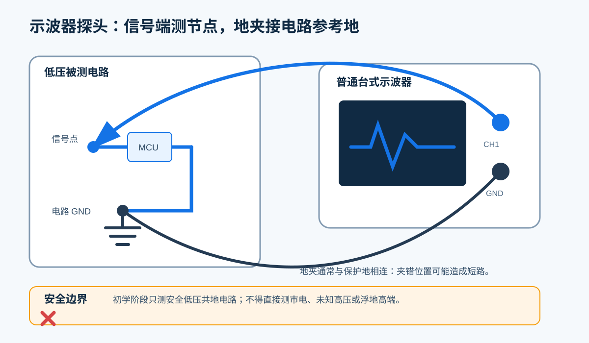
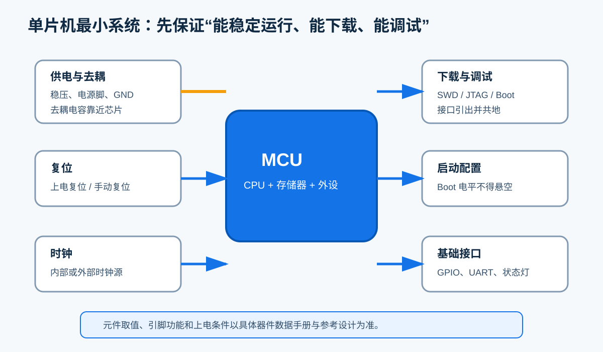
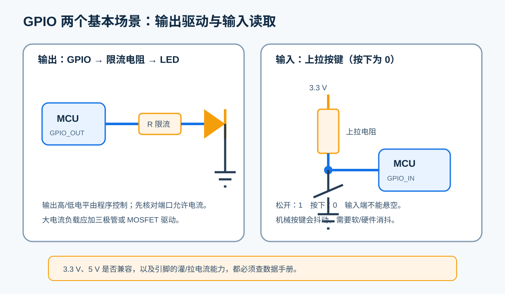
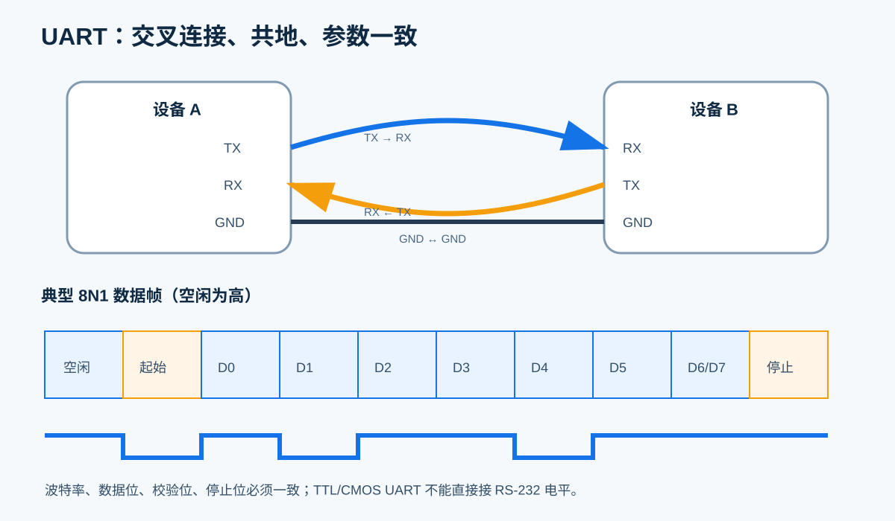

# 电子设计基础训练自学讲义（第4章）

> 适用对象：准备参加全国大学生电子设计竞赛、电子基础较弱的大一和大二学生 
> 本章主题：共同接口基础 
> 建议基础：完成安全、焊接返修、万用表与直流电源的入门学习

本章要解决的不是“会不会背某款单片机的函数”，而是让每位同学都能用同一种方式观察信号、说明接线、核对电平、记录接口。硬件和软件只有使用同一份接口约定，系统联调才不会陷入反复猜测。

本章按普通台式接地示波器、常见 3.3 V 单片机和低压实验电路编写。器件参数、引脚复用和极限额定值必须以对应芯片、开发板和模块的**数据手册**为准。

---

# 第4章 共同接口基础

## 4.1 学习目标

完成本章后，应能够：

1. 安全地使用示波器观察低压共地电路，并读出幅值、周期、频率和占空比；
2. 说清单片机最小系统中供电、去耦、复位、时钟、启动和下载调试接口的作用；
3. 区分 GPIO 输入、输出、上拉、下拉、推挽、开漏和高阻态；
4. 正确连接 UART 的 TX、RX 和 GND，解释波特率与 8N1 数据帧；
5. 用统一接口表把软硬件之间的约定写清楚；
6. 完成个人基线测试，并据此形成能力互补的小组。

## 4.2 为什么要建立共同接口语言

一个竞赛系统通常由传感器、信号调理、单片机、电机或显示模块以及算法程序组成。系统失败时，常见说法是“硬件没问题”或“程序没问题”，但这两句话都缺少可验证的信息。

更有效的描述应包含：

- **测量位置**：在哪个连接器、哪个引脚测量；
- **参考点**：电压相对于哪个 GND；
- **电气条件**：3.3 V 还是 5 V，输入还是输出，是否允许上拉；
- **时序条件**：信号频率、波特率、更新时间和超时时间；
- **逻辑含义**：高电平表示启动还是停止，数值的单位和范围是什么；
- **异常行为**：断线、越界或超时时，系统进入什么安全状态。

把这些信息写成接口契约，可以将“猜问题”变成“按证据定位问题”。

## 4.3 示波器：观察电压随时间的变化

### 4.3.1 示波器与万用表的区别

万用表适合测量较稳定的电压、电流和电阻；示波器显示的是电压随时间变化的波形。一个数字信号即使万用表显示约 1.6 V，也可能是在 0 V 与 3.3 V 之间快速切换。只有观察波形，才能判断边沿、干扰、占空比和通信时序。

示波器屏幕的纵轴表示电压，横轴表示时间。初学时先掌握以下项目：

| 项目 | 含义 | 调整思路 |
|---|---|---|
| V/div | 每个纵向格代表的电压 | 让波形占屏幕高度的 1/2～3/4 |
| s/div | 每个横向格代表的时间 | 让屏幕显示 2～5 个周期 |
| 触发 | 决定从波形的哪个条件开始刷新 | 常用边沿触发，电平设在波形中部 |
| DC/AC 耦合 | 是否保留直流分量 | 一般先用 DC；只观察小纹波时再考虑 AC |
| 探头倍率 | ×1 或 ×10 衰减 | 探头与通道菜单必须设置一致 |

### 4.3.2 波形的基本量

若一个周期性信号重复一次所需时间为周期 $T$，频率为 $f$，则：

$$
f=\frac{1}{T}, \qquad T=\frac{1}{f}
$$

若一个周期内高电平持续时间为 $t_H$，占空比 $D$ 为：

$$
D=\frac{t_H}{T}\times 100\%
$$

例如，测得周期为 1 ms，则频率为 1 kHz；高电平持续 0.25 ms，则占空比为 25%。

还需要认识：

- **峰峰值**：最高电压与最低电压之差；
- **上升时间**：信号从低电平上升到高电平所需的时间，常用 10%～90% 区间定义；
- **带宽**：示波器和探头可较可信测量的频率范围；
- **采样率**：每秒采集的样点数。采样率不足会产生失真甚至错误波形。

带宽、采样率越高并不意味着任意设置都正确。对一个未知信号，应先用较宽时间范围找到波形，再逐步缩小；不要只相信屏幕上的自动测量数字，还要观察波形是否稳定、是否削顶或混叠。

### 4.3.3 探头补偿与接地安全

使用无源探头前，应将探头接到示波器的校准方波端，调整补偿电容，使方波顶部平直。补偿不足会使边沿变圆，补偿过度会出现尖峰。

普通台式示波器的探头地夹通常与保护地相连。地夹不是“另一个随意选择的测量点”。把它夹到非参考地节点，可能直接短路该节点并损坏设备。

初学阶段遵守以下边界：

1. 只测安全低压、与示波器共地的实验电路；
2. 断电确认接线，先夹 GND，再接探头尖端；
3. 不直接测量市电、未知高压或浮地高端；
4. 不为了“浮起来测”而拔掉示波器保护地；
5. 不清楚参考地或电压范围时立即停止，请教师确认测量方案。

> 差分或隔离测量需要合适的差分探头、隔离设备和安全规范，不属于本章初学范围。

### 4.3.4 一套可复用的测量顺序

1. 明确待测信号的大致电压和频率范围；
2. 检查探头额定值、倍率和补偿；
3. 选择正确的电路 GND，断电连接地夹；
4. 先使用较大的 V/div 和较慢的 s/div，再逐步调整；
5. 设置触发源、上升沿或下降沿、触发电平，使波形稳定；
6. 读出最低值、最高值、峰峰值、周期、频率、占空比；
7. 保存波形或拍照，并记录探头倍率、测量点和示波器设置。

建议使用下表记录结果：

| 日期 | 测量点/参考地 | 探头倍率 | V/div | s/div | Vmin/Vmax | 频率 | 占空比 | 观察结论 |
|---|---|---:|---:|---:|---:|---:|---:|---|
|  |  |  |  |  |  |  |  |  |

## 4.4 单片机最小系统

单片机最小系统是让 MCU 能稳定启动、运行程序并接受下载调试所必需的电路集合。不同芯片的具体要求不同，但通常包括以下部分。

### 4.4.1 供电、地与去耦

- 每个电源脚和地脚都应按数据手册连接，不能只接“看起来够用”的一组；
- 电源电压必须在允许范围内，电源应具有足够电流能力；
- 常见做法是在每个电源脚附近放置 0.1 μF 去耦电容，但数量、容量和组合以参考设计为准；
- 较大的储能电容负责较低频率的电流变化，小去耦电容负责较高频率的瞬态电流；
- 模拟电源、参考电压等特殊引脚必须按数据手册处理。

去耦电容“有”还不够，连接路径应短，位置应靠近芯片电源脚。长导线会增加寄生电感，使电容对快速干扰的抑制能力下降。

### 4.4.2 复位、时钟和启动配置

- **复位**：让芯片回到确定的初始状态。复位脚不能随意悬空；
- **时钟**：可来自内部振荡器或外部晶振/有源时钟。时钟配置错误会导致程序不运行或通信速率错误；
- **启动配置**：Boot 引脚或配置字决定从何处启动。其默认电平应确定；
- **下载调试**：SWD、JTAG 或其他接口需要正确引出数据、时钟、复位、电源参考和 GND。

### 4.4.3 最小系统上电检查

建议按照“先静态、后动态”的顺序检查：

1. 断电测量电源与 GND 之间是否近似短路；
2. 给直流电源设置正确电压和合理限流值；
3. 上电观察电流是否异常，触摸检查前必须断电；
4. 用万用表确认 MCU 各电源脚电压；
5. 检查复位脚和启动脚的静态电平；
6. 尝试连接下载器并读取器件信息；
7. 下载最简单的心跳灯程序；
8. 再用示波器观察时钟、复位或 GPIO 波形。

若下载器无法连接，可按“供电 → GND → 复位 → 启动配置 → 调试接口顺序 → 时钟/固件”的顺序排查。不要一开始就反复重装软件。

## 4.5 GPIO：最基本的数字接口

GPIO 是通用输入输出口。软件配置决定引脚是读取外部电平，还是向外输出高、低电平。

### 4.5.1 数字电平并非精确的 0 V 和 3.3 V

数字输入通过阈值把连续电压判定为 0 或 1。低于某个阈值才可靠识别为低，高于另一个阈值才可靠识别为高，中间区域可能不确定。不同芯片、不同引脚的阈值不同。

因此：

- 不要仅凭“差不多 3 V”判断一定为高；
- 不要假设所有 3.3 V MCU 引脚都能承受 5 V；
- 外接 5 V 模块前，查清输入高低阈值、绝对最大额定值及是否 5 V tolerant；
- 需要时使用分压、电平转换器或合适的缓冲器。

### 4.5.2 输入模式

- **浮空输入**：外部不驱动时电平不确定，容易受干扰；
- **上拉输入**：通过电阻把默认状态拉到高电平；
- **下拉输入**：通过电阻把默认状态拉到低电平；
- **高阻态**：引脚对外呈现很高阻抗，几乎不主动吸收或输出电流。

机械按键会在接通和断开瞬间快速抖动。程序若每次变化都计数，可能把一次按键识别成多次。常见方法是硬件 RC 滤波或软件延时/状态机消抖。

### 4.5.3 输出模式

- **推挽输出**：能够主动拉高和拉低，适合一般数字输出；
- **开漏输出**：通常只能主动拉低，释放时为高阻态，需要外部或内部上拉；多个开漏器件可在满足规范时共用一根线；
- **输出电流限制**：GPIO 适合逻辑信号和小电流负载，不可直接驱动电机、继电器或大功率灯。

LED 必须串联限流电阻。若已知电源电压 $V_{CC}$、LED 正向压降 $V_F$ 和目标电流 $I$，可估算：

$$
R=\frac{V_{CC}-V_F}{I}
$$

计算结果还要结合 GPIO 灌电流/拉电流能力、LED 亮度需求和电阻标准值调整。初学时应优先选择较小电流，而不是追求最亮。

### 4.5.4 GPIO 逻辑表

接口实现前先写逻辑表，比直接写代码更不容易出错。

| 对象 | GPIO 模式 | 外部电路 | 电平 | 逻辑含义 | 上电默认 |
|---|---|---|---:|---|---|
| 状态 LED | 推挽输出 | 串联限流电阻 | 1 | 点亮（示例） | 0，熄灭 |
| 启动按键 | 上拉输入 | 按键接 GND | 0 | 按下 | 1，松开 |
| 故障输出 | 开漏输出 | 外部上拉 | 0 | 故障有效 | 释放，高阻态 |

注意：部分开发板 LED 是低电平点亮，不能把示例逻辑直接照搬。以原理图和实测为准。

## 4.6 UART：最常用的调试与模块通信接口

UART 是异步串行通信。异步表示双方不共享时钟线，因此发送端与接收端必须预先约定波特率、数据位、校验位和停止位。

### 4.6.1 接线规则

- 设备 A 的 **TX → RX**（设备 B）；
- 设备 A 的 **RX → TX**（设备 B）；
- 两侧 **GND ↔ GND**；
- 先确认双方逻辑电平兼容，再接信号线；
- TTL/CMOS UART 与 RS-232 的电气电平和极性不同，不能直接相连，需要专用电平转换芯片。

USB 转串口模块通常把计算机 USB 转成 TTL/CMOS UART，但模块可能支持 3.3 V 或 5 V。连接前必须确认其 TX 输出电平、目标板引脚耐压和 GND。

### 4.6.2 波特率与 8N1

波特率在常见二进制 UART 中可近似理解为每秒传输的比特数。115200 baud 时，每比特时间约为：

$$
t_{bit}=\frac{1}{115200}\approx 8.68\ \mu s
$$

“8N1”表示 8 个数据位、无校验、1 个停止位。若每个字节还包含 1 个起始位，则一字节通常需要 10 bit，理论上最多约传输 11520 byte/s；实际有效速度还会受协议和处理时间影响。

### 4.6.3 从字符到数据帧

调试阶段发送 `hello` 很方便，但正式系统需要知道一帧数据从哪里开始、长度是多少、是否出错。可使用如下简单结构：

| 帧头 | 长度 | 命令 | 数据 | 校验 |
|---|---|---|---|---|
| 0xAA 0x55 | 1 byte | 1 byte | N byte | 1 byte |

接收程序不应假定“一次读取恰好得到一整帧”，而应逐字节进入缓冲区，用状态机寻找帧头、检查长度和校验，并设置超时。校验和只能发现一部分传输错误，不等同于安全或加密。

### 4.6.4 UART 故障速查

| 现象 | 优先检查 |
|---|---|
| 完全无数据 | 供电、GND、TX/RX 是否交叉、引脚复用、发送程序是否执行 |
| 全是乱码 | 波特率、时钟配置、数据位/校验/停止位、逻辑电平 |
| 只能单向通信 | 另一方向 TX/RX 接线、该引脚模式、接收中断或缓冲区 |
| 偶发丢帧 | 共地与干扰、线长、缓冲区溢出、处理阻塞、协议超时 |
| 复位后误动作 | 上电默认电平、接收残留数据、协议同步和异常处理 |

使用示波器观察 UART 时，应先测空闲电平，再测单个重复字符。若发送 `0x55`，数据位会形成较规则的交替电平，便于估算比特时间和判断波特率。

## 4.7 统一接口表：软硬件共同签署的契约

接口表不是项目结束后的说明书，而是在接线和编程前共同确认的设计输入。任何修改都应更新版本并通知相关成员。

### 4.7.1 空白模板

| 模块/信号 | 连接器与引脚 | 方向（以主控为准） | 电平/电气类型 | 默认状态 | 有效逻辑 | 数据单位/量程 | 时序/更新率 | 协议/格式 | 异常处理 | 负责人 | 版本 |
|---|---|---|---|---|---|---|---|---|---|---|---|
|  |  |  |  |  |  |  |  |  |  |  |  |

至少必须写清以下字段：**引脚、方向、电平、默认状态、单位/量程、时序、异常处理**。仅写“串口通信”或“接传感器”不合格。

### 4.7.2 示例

| 模块/信号 | 连接器与引脚 | 方向 | 电平/电气类型 | 默认状态 | 有效逻辑 | 数据单位/量程 | 时序/更新率 | 协议/格式 | 异常处理 | 负责人 | 版本 |
|---|---|---|---|---|---|---|---|---|---|---|---|
| 状态灯 LED_RUN | J3-2 / PA5 | 输出 | 3.3 V 推挽 | 低 | 高电平亮 | 无 | 2 Hz 闪烁 | 无 | 主循环超时则常灭 | 硬件A/软件B | v1.0 |
| 测距 UART_RX | J4-3 / PB7 | 输入 | 3.3 V CMOS | 上拉高 | 低起始位 | mm / 0～5000 | 10 Hz，100 ms 超时 | 115200, 8N1；帧格式见协议 | 超时置无效标志并停止运动 | 硬件C/软件B | v1.0 |

### 4.7.3 命名和版本规则

- 名称应表达功能，如 `MOTOR_EN`，不要只写 `GPIO1`；
- 低电平有效可用 `_N` 后缀，并在表中再次说明；
- 数值必须写单位，角度、距离、速度不能只有“一个整数”；
- 标明方向的参考对象，例如“以主控为准”；
- 每次修改记录版本、日期、修改人和影响范围；
- 原理图、PCB、程序宏定义和接口表中的名称应一致。

## 4.8 基线测试与分组依据

基线测试的目的不是给学生贴标签，而是发现需要补强的基础，并组成能力互补的队伍。建议每人独立完成，按过程证据评分。

### 4.8.1 个人基线测试记录表

| 模块 | 可观察证据 | 分值 | 得分 | 主要问题 |
|---|---|---:|---:|---|
| 示波器 | 正确接地；稳定显示低压方波；读出幅值、频率、占空比；保存带设置的波形 | 25 |  |  |
| 最小系统 | 能指出供电、去耦、复位、时钟、Boot、下载调试接口，并按顺序排查 | 20 |  |  |
| GPIO | 解释上拉按键和限流 LED；能判断输入输出、默认状态及有效逻辑 | 20 |  |  |
| UART | 正确完成 TX/RX/GND 接线；统一 8N1 参数；发送和接收已知数据 | 20 |  |  |
| 接口文档 | 独立填写一行完整接口表，单位、范围、时序和异常处理明确 | 15 |  |  |
| 合计 |  | 100 |  |  |

参考判定：80 分及以上可独立完成基础联调；60～79 分需要针对性复练；低于 60 分应在同伴或教师指导下重新完成薄弱项。分数不是永久分组依据，应随训练更新。

### 4.8.2 分组表模板

| 姓名 | 示波器 | 接线与安全 | GPIO | UART | 文档表达 | 当前薄弱项 | 组内首轮职责 | 复测日期 |
|---|---:|---:|---:|---:|---:|---|---|---|
|  |  |  |  |  |  |  |  |  |
|  |  |  |  |  |  |  |  |  |
|  |  |  |  |  |  |  |  |  |

建议按三人一组配置：至少一人测量与接线较稳，一人逻辑与程序较稳，一人记录与复现较稳。职责应轮换，不能把学生永久分成只碰硬件或只写软件的两类。每个人都必须能完成低压安全测量、GPIO 基础调试和 UART 联调。

## 4.9 本章学习验收

满足以下条件，视为具备进入后续轮训的共同基础：

- 能解释普通台式示波器地夹的风险，并拒绝测量超出能力范围的对象；
- 能把一个安全低压方波调到稳定显示，测量结果与已知值基本一致；
- 能在原理图或开发板资料中找到 MCU 电源、GND、复位、Boot 和下载接口；
- 能说明推挽、开漏、上拉、下拉与高阻态的差异；
- 能根据电平和电流限制判断 GPIO 是否可以直接连接某模块；
- 能完成 UART 交叉接线、参数统一、收发测试和基本故障定位；
- 能填写统一接口表，不遗漏电气、逻辑、时序和异常信息；
- 能提交个人基线测试表和三人分组表。

## 4.10 自测题

1. 为什么万用表测得 1.6 V，不能说明数字引脚真的稳定在 1.6 V？
2. 1 kHz 方波的周期是多少？高电平 0.2 ms 时占空比是多少？
3. 示波器波形一直左右滚动，最先应检查哪个功能？
4. 普通台式示波器的地夹为什么不能夹到任意节点？
5. 为什么去耦电容要靠近 MCU 电源脚？
6. MCU 无法下载程序时，列出至少四项检查内容。
7. 浮空输入为什么会随机变化？
8. 推挽输出与开漏输出的主要区别是什么？
9. 3.3 V MCU 能否直接接 5 V 模块的 TX？应依据什么判断？
10. UART 为什么要 TX 接 RX？为什么还要共地？
11. 115200、8N1 时，传输一个字节通常占多少 bit？理论字节率约为多少？
12. 接口表中为什么既要写“电平”，又要写“有效逻辑”？
13. 若通信超时，接口表至少应说明什么？
14. 为什么不建议按一次测试成绩把学生永久分为硬件和软件两组？

参考答案

1. 引脚可能在高低电平之间快速切换，万用表只显示平均效果；应用示波器观察。
2. 周期 1 ms，占空比 20%。
3. 检查触发源、触发边沿和触发电平。
4. 地夹通常与保护地相连，夹错会把该节点短接到地。
5. 缩短瞬态电流回路，降低走线寄生参数带来的影响。
6. 供电、共地、复位、Boot、调试线序、下载器设置、时钟或固件占用引脚等。
7. 引脚没有确定的电流通路，容易受电场和噪声影响。
8. 推挽可主动拉高和拉低；开漏通常只主动拉低，释放时为高阻，需要上拉。
9. 不能凭经验判断；查 MCU 引脚极限额定值、是否耐 5 V 和模块输出电平，必要时做电平转换。
10. 发送端要接对方接收端；共地为信号电压提供共同参考。
11. 通常 10 bit，理论约 11520 byte/s。
12. 电平说明电气条件，有效逻辑说明“高/低代表什么”，二者不是同一件事。
13. 超时时间、无效标志、安全状态、是否重试及恢复条件。
14. 竞赛联调需要共同语言；职责轮换能避免单点依赖，并让分组随能力变化而调整。

## 4.11 常见错误速查

| 错误 | 后果 | 改进 |
|---|---|---|
| 示波器地夹夹在高端节点 | 短路、损坏器件或产生安全风险 | 先确认参考地，只测安全低压共地电路 |
| 探头设为 ×10，示波器通道设为 ×1 | 幅值读数相差 10 倍 | 探头和通道倍率保持一致 |
| GPIO 输入悬空 | 读数随机、误触发 | 使用合适的上拉或下拉 |
| LED 不串限流电阻 | LED 或 GPIO 过流损坏 | 计算并选择限流电阻 |
| 把 3.3 V 与 5 V 直接相连 | 输入过压或逻辑不可靠 | 查数据手册并做电平匹配 |
| UART TX 接 TX | 双方都在发送，接收不到 | TX → RX，RX → TX，并共地 |
| TTL/CMOS UART 直接接 RS-232 | 电平和极性错误，可能损坏 | 使用匹配的收发器 |
| 接口表只写“串口” | 联调时反复猜参数 | 写清引脚、电平、波特率、格式、超时和异常处理 |

---

# 延伸学习资料

以下资料用于查阅原理和规范。阅读英文资料时，可先看图、术语表和操作章节，再结合本章内容核对。

1. Tektronix, *Oscilloscope Basics*：https://www.tek.com/en/documents/primer/oscilloscope-basics
2. STMicroelectronics, *AN4488: Getting started with STM32F4xxxx MCU hardware development*：https://www.st.com/resource/en/application_note/an4488-getting-started-with-stm32f4xxxx-mcu-hardware-development-stmicroelectronics.pdf
3. Microchip Online Documentation, *Universal Asynchronous Receiver Transmitter (UART)*：https://onlinedocs.microchip.com/oxy/GUID-04B5982F-17EC-4A6E-B7FE-72DF0A5463B9-en-US-3/GUID-60D664F7-9847-4251-BC6E-5D52309014DD.html
4. ARM, *CMSIS documentation*：https://arm-software.github.io/CMSIS_6/latest/General/index.html

> 资料中的具体电压、引脚和电路不能脱离所用器件直接套用。最终设计依据始终是当前器件的数据手册、参考手册、原理图和勘误表。

