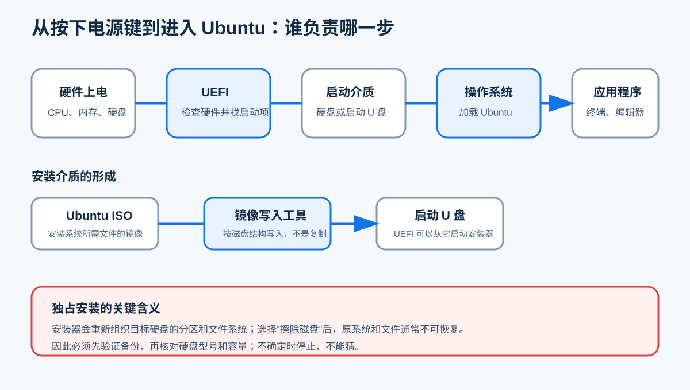
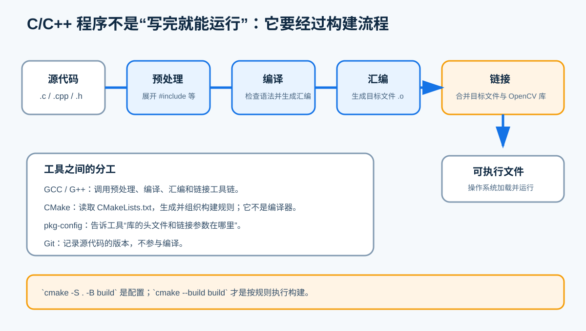
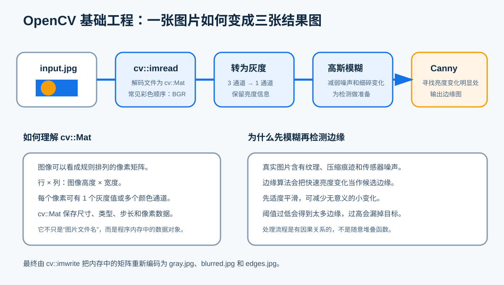

# Ubuntu 与 OpenCV 开发基础概念

> 配套材料：《Ubuntu 与 OpenCV 开发环境一周任务书》<br>
> 阅读对象：第一次接触 Linux、C/C++ 构建和 OpenCV 的学生<br>
> 本文目的：先弄清“这些东西是什么、为什么要做”，再按照任务书动手

这不是另一份安装步骤。任务书告诉你“做什么”，本文解释每一步背后的对象和因果关系。第一次阅读时不必记住全部名词，先形成一张完整地图；真正操作时，再回来查对应章节。

安全边界必须先说明：任务书采用 Ubuntu 独占安装，选择“擦除磁盘并安装 Ubuntu”会清空目标硬盘上的原系统、分区和文件。数据通常不可恢复。必须先验证备份，再核对硬盘型号与容量；本文不提供手动分区、修改 RST/AHCI、绕过 Secure Boot 等操作指导，不确定时停止并请教师确认。

---

## 1 先看全局：这一周到底在搭建什么

这一周不是简单地“安装几个软件”，而是在一台实体计算机上建立一条完整开发链：

```text
计算机硬件
  ↓
Ubuntu 操作系统
  ↓
C/C++ 开发工具
  ↓
OpenCV 库
  ↓
自己的源代码
  ↓
可以运行的图像处理程序
```

可以把它类比成建立一间电子工作室：

| 计算机概念 | 工作室类比 | 在任务中的作用 |
|---|---|---|
| Ubuntu 操作系统 | 房间、工作台和管理制度 | 管理硬件、文件、用户和程序 |
| APT 软件仓库 | 可信的工具仓库与领用系统 | 查找并安装开发工具 |
| GCC/G++ | 加工设备 | 把 C/C++ 源代码加工成机器能执行的文件 |
| CMake | 工艺流程单 | 说明有哪些源文件、需要哪些库、怎样构建 |
| OpenCV | 已做好的专业工具箱 | 提供读取、转换、滤波、边缘检测等功能 |
| Git | 带时间记录的版本档案柜 | 保存代码变化，便于比较和恢复 |

最终成果不是“电脑里出现了 Ubuntu 图标”，而是你知道每一层的作用，能够从源代码重新构建程序，并能根据报错判断问题发生在哪一层。

## 2 从开机到进入 Ubuntu

### 2.1 什么是操作系统

**直观类比：** 操作系统像实验室管理员。程序不能各自随意占用设备，管理员负责分配工作台、登记工具和协调人员。

**准确解释：** 操作系统位于硬件与应用程序之间，负责管理 CPU、内存、硬盘、显示器、键盘、网络等资源，并提供文件、用户、进程和设备接口。Windows、macOS、Ubuntu 都是操作系统。

**为什么需要：** 你的 C++ 程序不会直接控制所有硬件。它通过操作系统申请内存、读取文件、显示窗口和访问摄像头。

### 2.2 Linux、Ubuntu 和 LTS 是什么关系

- **Linux** 严格来说是内核。内核是操作系统最核心的部分，负责管理硬件、内存、进程和驱动；
- **Linux 发行版**把 Linux 内核、系统工具、桌面、软件仓库和安装程序组合成可直接使用的系统；
- **Ubuntu** 是常见的 Linux 发行版之一；
- **Ubuntu Desktop** 是面向个人计算机、带图形桌面的 Ubuntu 版本；
- **LTS** 是 Long Term Support（长期支持）的缩写，强调较长时间的安全更新和维护，更适合教学环境和长期项目。

常见误解：“Linux 和 Ubuntu 是两个完全无关的系统。”更准确的说法是：Ubuntu 使用 Linux 内核，并在其上提供完整的桌面和软件生态。

### 2.3 ISO 镜像与启动 U 盘

**ISO 镜像**是一个文件，里面保存了安装介质应有的目录、文件和结构。它类似一张“安装光盘的完整数字副本”，不是普通压缩包。

**启动 U 盘**是把 ISO 按启动介质所需结构写入 U 盘后的结果。直接把 `.iso` 文件复制进 U 盘，通常不能得到可启动介质；镜像写入工具会重写 U 盘结构，因此会清除 U 盘原有内容。

**为什么需要：** 空白硬盘上还没有 Ubuntu。计算机必须先从另一个可启动介质运行安装程序，这个介质通常就是启动 U 盘。

### 2.4 SHA-256 为什么能检查下载文件

SHA-256 会根据文件全部内容计算出一串固定长度的摘要。文件只要有微小变化，摘要通常就会完全不同。

它像文件的“内容指纹”，但不是用文件名判断。两个都叫 `ubuntu.iso` 的文件，内容不同就会得到不同摘要。

在任务中计算 SHA-256，是为了回答两个问题：

1. 下载过程中是否发生损坏；
2. 手里的文件是否与官方发布的文件一致。

SHA-256 一致不能证明计算机以后绝不会出问题，但能显著降低“镜像本身已损坏或不是指定版本”的风险。

### 2.5 UEFI、Boot 和启动顺序

按下电源键后，应用程序不会立即出现。现代计算机通常先运行 UEFI 固件：

1. 检查和初始化基本硬件；
2. 查找可启动设备和启动项；
3. 按启动顺序选择硬盘或 U 盘；
4. 把控制权交给操作系统的启动程序。

**Boot** 就是启动。启动菜单允许本次开机临时选择从哪个设备启动。选择带 UEFI 标识的启动 U 盘，是让计算机运行 Ubuntu 安装环境，而不是继续进入原系统。



### 2.6 硬盘、分区和文件系统

这三个概念经常被混在一起：

- **硬盘**：实际的存储设备，例如 512 GB NVMe SSD；
- **分区**：在一块硬盘上划出的逻辑区域；
- **文件系统**：规定文件、目录、空间和元数据如何存放的组织方式，例如 ext4；
- **挂载**：把一个文件系统接到 Linux 目录树的某个位置，使程序能够通过路径访问。

类比一栋楼：硬盘是整栋楼，分区是划分的房间，文件系统是每个房间的编号和收纳规则，挂载点是入口地址。

### 2.7 独占安装与双系统

**独占安装**表示目标硬盘主要由 Ubuntu 使用。任务书中的“擦除磁盘并安装 Ubuntu”会重新建立分区和文件系统，原 Windows、软件和个人文件会被清除。

**双系统**表示一台计算机保留两个操作系统，开机时选择进入哪一个。它要处理现有分区、引导项、BitLocker、不同存储控制模式和两套系统的数据安全，复杂度更高。

本周为什么先做独占安装：

- 环境统一，学生之间的问题更容易复现；
- 避免在基础不足时手工调整已有分区；
- 把注意力集中到 Linux 和开发工具，而不是复杂引导问题。

这不表示独占安装“没有风险”。相反，它的风险非常明确：**选错目标硬盘就会擦除错误的数据**。所以备份与核对硬盘不是形式要求，而是安装流程的一部分。

## 3 在 Ubuntu 中找到并管理软件

### 3.1 桌面、终端和 Shell

Ubuntu Desktop 同时提供图形界面和终端。

- **桌面**适合用鼠标打开文件、浏览网页和启动应用；
- **终端**是输入文本命令的窗口；
- **Shell** 是读取命令、解释命令并调用程序的工具，Ubuntu 常见 Shell 为 Bash。

终端不是“黑色的高级模式”，它只是另一种人与系统交流的界面。开发任务经常使用终端，是因为命令容易记录、复制、复现和写入文档。

### 3.2 命令的基本结构

一条命令通常由“程序名＋选项＋参数”组成：

```text
程序名    选项            参数
gcc      -Wall -o        hello hello.c
```

- `gcc`：要运行的程序；
- `-Wall`、`-o`：改变程序行为的选项；
- `hello`、`hello.c`：命令处理的对象。

空格用于分隔各部分，大小写通常有区别。看到命令时，应先问“第一个单词是什么程序”，再看后面的选项和文件。

### 3.3 路径、目录与当前工作目录

路径是文件或目录在文件系统中的位置。

- `/`：根目录，Linux 目录树的起点；
- `/home/zhang/opencv_week1`：绝对路径，从根目录写起；
- `data/input.jpg`：相对路径，从当前工作目录写起；
- `~`：当前用户主目录的简写；
- `.`：当前目录；
- `..`：上一级目录。

`pwd` 用于查看当前目录，`ls` 用于列出目录内容，`cd` 用于切换目录。程序提示“读取图片失败”时，很多情况下不是 OpenCV 坏了，而是当前目录与相对路径不匹配。

### 3.4 用户、权限与 sudo

Linux 会区分文件属于谁、谁可以读取、修改或执行。普通用户默认不能随意修改系统关键文件。

`sudo` 表示以管理员权限执行紧随其后的命令。它像临时领取总钥匙：只在确实需要修改系统时使用，并且必须理解要执行的命令。

为什么安装软件需要 `sudo`：软件包会写入系统目录并更新系统数据库。为什么运行自己目录里的普通程序通常不需要 `sudo`：它不应修改系统关键位置。

常见误解：“报权限错误就在前面加 sudo。”这是危险做法。权限错误也可能来自路径写错、文件所有者异常或不合理的操作目标。

### 3.5 软件仓库、APT、软件包和依赖

**软件仓库**是按发行版规则组织的软件集合。Ubuntu 官方仓库中的软件包经过统一构建和索引。

**软件包**通常包含程序文件、库、配置说明、版本和依赖信息。`libopencv-dev` 是 OpenCV 的开发包，其中包括编译程序需要的头文件和库信息。

**依赖**表示一个软件需要另一个软件或库才能工作。例如，一个 OpenCV 程序可能依赖图像编解码库。

**APT** 是 Ubuntu 常用的软件包管理工具：

- `apt update` 更新“有哪些软件及版本可用”的本地索引，不等于升级所有软件；
- `apt upgrade` 根据索引升级已安装的软件包；
- `apt install` 安装指定软件并处理依赖。

类比图书馆：软件仓库是馆藏，软件包索引是目录，`apt update` 是更新目录，`apt install` 才是按目录取书并办理借阅。

为什么优先使用软件仓库：来源和版本关系相对清楚，APT 能统一处理依赖和后续更新。随意加入未知第三方源，会把系统的信任交给陌生发布者，也可能造成版本冲突。

## 4 C/C++ 程序怎样变成可以运行的文件

### 4.1 源代码不等于可执行文件

`hello.cpp` 是人可以阅读和修改的源代码；CPU 不能直接把这段文字当作机器指令执行。构建工具要把源代码转换成目标平台可运行的文件。

修改源代码后，如果没有重新构建，旧的可执行文件不会自动改变。这就是为什么任务书要求“修改输出内容后重新编译”。

### 4.2 四个主要阶段



1. **预处理**：处理 `#include`、`#define` 等预处理指令；
2. **编译**：检查语言规则并把代码转换为较低层表示或汇编代码；
3. **汇编**：把汇编代码转换成目标文件，常见扩展名为 `.o`；
4. **链接**：把一个或多个目标文件与所需库组合成可执行文件。

平时执行一条 `gcc` 或 `g++` 命令时，工具链可以连续完成这些阶段，所以学生不一定看见中间文件，但阶段仍然存在。

### 4.3 头文件与库

使用别人写好的功能通常需要两类信息：

- **头文件**告诉编译器有哪些函数、类和数据类型可以使用；
- **库文件**包含这些功能已经编译好的实现，链接阶段把程序与它们连接起来。

只写 `#include <opencv2/...>` 并不意味着 OpenCV 实现已经进入自己的程序。编译器还要找到头文件，链接器还要找到正确的 OpenCV 库。

### 4.4 编译错误、链接错误与运行错误

| 类型 | 发生阶段 | 常见现象 | 优先检查 |
|---|---|---|---|
| 编译错误 | 源代码转换时 | 语法错误、类型不匹配、找不到头文件 | 文件名、行号、第一条错误、头文件路径 |
| 链接错误 | 合并目标文件和库时 | `undefined reference` | 是否链接所需库、函数签名是否一致 |
| 运行错误 | 程序已经启动后 | 文件读不到、参数不足、崩溃 | 运行参数、当前路径、输入数据和边界条件 |

排错时先判断属于哪个阶段，可以把搜索范围缩小很多。

## 5 GCC、G++、CMake、Git 和 pkg-config 各做什么

### 5.1 GCC 与 G++

GCC 既可以指 GNU Compiler Collection 这套编译器集合，也常指命令 `gcc`。在本任务中：

- `gcc` 用于构建 C 程序；
- `g++` 用于构建 C++ 程序，并自动按 C++ 方式处理和链接常用 C++ 标准库。

任务书中的 `-Wall` 和 `-Wextra` 用于开启更多警告，帮助发现可疑代码；`-O2` 请求常用级别的优化；`-o hello` 指定输出文件名。警告不一定阻止构建，但不应在看不懂时直接忽略。

### 5.2 CMake

CMake 不是编译器。它是构建系统生成和组织工具，读取 `CMakeLists.txt` 中的项目说明，再生成实际构建所需的规则。

任务书中几个关键语句的含义：

- `project(...)`：定义项目及所用语言；
- `find_package(OpenCV ...)`：寻找 OpenCV 的配置和所需组件；
- `add_executable(...)`：说明哪些源文件组成可执行程序；
- `target_link_libraries(...)`：说明目标需要链接哪些库；
- `target_compile_options(...)`：为目标设置编译选项。

两条命令分工不同：

```bash
cmake -S . -B build      # 配置：读取工程说明，在 build 中生成构建规则
cmake --build build      # 构建：调用实际构建工具和编译器
```

把生成文件放进 `build` 目录叫“源外构建”。删除 `build` 后，源代码仍在，可以重新配置和构建，所以任务书才要求练习从空构建目录重建。

### 5.3 pkg-config

第三方库可能安装在多个目录。`pkg-config` 读取库提供的 `.pc` 元数据，输出版本、头文件搜索路径和链接参数。

`pkg-config --modversion opencv4` 能输出版本，表示它找到了名为 `opencv4` 的开发信息。这能说明安装链的一部分正常，但不能代替真正编译和运行 OpenCV 程序。

### 5.4 Git

Git 是版本控制工具，用来记录文件随时间的变化。它可以回答：改了什么、谁改的、何时改的，并允许回到已提交的版本。

Git 不负责下载 Ubuntu 软件包，不负责调用 C++ 编译器，也不等于 GitHub。Git 可以完全在本地工作；GitHub 是托管 Git 仓库的网络平台之一。

本周先安装 Git，是为了让后续项目具备版本管理能力。提高任务要求形成有意义的提交，是训练“每完成一个可解释阶段就留下快照”。

## 6 OpenCV 怎样处理一张图像

### 6.1 OpenCV 是什么

OpenCV 是开源计算机视觉与图像处理库，不是编程语言。它提供 C++、Python 等接口，封装了图像读写、颜色转换、滤波、特征、几何变换、视频处理等大量功能。

为什么不从零写所有算法：成熟库可以减少重复工作，并提供经过广泛使用的实现。使用库仍需理解输入、输出、参数和限制，不能把函数当作“魔法按钮”。

### 6.2 图像、像素、通道和矩阵

数字图像可以看成规则排列的像素网格：

- **像素**是图像中的一个采样位置；
- **宽度**是列数，**高度**是行数；
- **通道**表示每个像素包含几组数值；
- 灰度图常用 1 个通道，彩色图常用 3 个通道；
- 在 OpenCV 的常见默认彩色表示中，通道顺序是 **BGR**，不是很多人习惯说的 RGB。

OpenCV C++ 中常用 `cv::Mat` 保存图像。它可以理解为“带有尺寸、数据类型、步长和内存管理信息的矩阵对象”，不仅是图片文件名。

图片文件与 `cv::Mat` 的关系：JPEG/PNG 是磁盘上的编码文件；`cv::imread` 解码文件并生成内存中的矩阵；`cv::imwrite` 把矩阵重新编码并写回文件。

### 6.3 灰度、模糊与边缘检测



#### 灰度转换

彩色图像包含多个颜色通道。灰度转换把颜色信息综合成单通道亮度表示。这样后续算法处理的数据更少，也更聚焦于明暗结构。

灰度不是简单地“只取某一个颜色”，而是按规定方式组合颜色通道。任务中的 `cvtColor` 负责执行该转换。

#### 高斯模糊

图像中的细小纹理、压缩痕迹和传感器噪声也会造成亮度变化。高斯模糊用邻域加权平均减弱细碎变化，使图像更平滑。

为什么边缘检测前先模糊：边缘算法对变化敏感，先适度降噪可以减少虚假边缘。模糊过强也会损失真实细节，因此参数需要折中。

#### Canny 边缘检测

边缘通常出现在亮度变化明显的位置。Canny 是多阶段边缘检测方法，包括降噪、计算梯度、细化候选边缘和双阈值连接等步骤。

任务中的两个阈值不是“越大越好”：低阈值太低会保留大量噪声，高阈值太高会漏掉真实边缘。输出通常是单通道边缘图，白色位置表示检测到的边缘。

### 6.4 任务程序的数据流

```text
data/input.jpg
    ↓ cv::imread
彩色 cv::Mat（BGR）
    ↓ cv::cvtColor
gray（灰度）
    ↓ cv::GaussianBlur
blurred（平滑后的灰度图）
    ↓ cv::Canny
edges（边缘图）
    ↓ cv::imwrite
output/gray.jpg、blurred.jpg、edges.jpg
```

如果 `image.empty()` 为真，说明图片没有成功读入。常见原因包括路径错误、文件不存在、权限不足或文件内容损坏。此时继续做颜色转换没有意义，所以程序先检查再处理。

## 7 怎样看懂路径、命令和报错

### 7.1 先找报错发生在哪一层

面对报错，不要立刻复制网上的命令。先判断层次：

| 层次 | 典型问题 |
|---|---|
| 启动与安装 | 找不到启动 U 盘、目标硬盘不明确 |
| 网络与 APT | 域名无法访问、索引下载失败、软件包不存在 |
| 编译 | 语法错误、头文件找不到 |
| 链接 | OpenCV 库未找到、符号未定义 |
| 运行 | 参数错误、图片路径错误、输出目录权限问题 |
| 算法结果 | 图像能生成，但阈值或处理效果不合适 |

层次不同，解决方法不同。网络故障不应通过修改 C++ 源代码解决；路径错误也不应通过重装 OpenCV 解决。

### 7.2 第一条错误往往最重要

一次编译可能输出几十行错误，后面的错误可能由第一处错误连锁产生。记录时应保留：

- 完整命令；
- 当前目录 `pwd`；
- 第一条错误及其前后文字；
- 涉及的文件名和行号；
- 预期结果和实际结果。

不要只写“不能运行”“报红了”。这样的记录无法复现。

### 7.3 “现象—假设—检查—结果”

示例：程序提示读取图片失败。

```text
现象：程序输出“读取图片失败: data/input.jpg”。
假设1：当前目录不对。
假设2：图片文件名或大小写不一致。
假设3：图片不是有效文件。
检查：执行 pwd、ls -lh data/input.jpg、file data/input.jpg。
结果：pwd 显示当前在 build 目录，相对路径从 build 开始计算。
结论：回到项目根目录运行，图片成功读取。
```

一次只做能区分假设的检查。连续复制十几条命令，即使偶然修好，也很难知道真正原因。

## 8 概念与任务书对照表

| 任务书环节 | 需要理解的概念 | 为什么要做 | 能说明什么 |
|---|---|---|---|
| 校验 Ubuntu 镜像 | ISO、SHA-256 | 排除下载损坏或文件不一致 | 安装介质来源和内容可核对 |
| 制作启动 U 盘 | 镜像写入、启动介质 | 让 UEFI 能运行安装器 | U 盘不是简单保存 ISO 文件 |
| 从 U 盘启动 | UEFI、Boot、启动顺序 | 在硬盘系统之外运行安装环境 | 计算机找到正确启动项 |
| 独占安装 | 硬盘、分区、文件系统 | 为 Ubuntu 建立完整存储结构 | 目标硬盘会被擦除，备份不可省略 |
| 查看系统信息 | 操作系统、内核、块设备 | 留下可复查的环境证据 | 安装结果、内核和磁盘信息明确 |
| `apt update/upgrade` | 仓库、索引、软件包、依赖 | 获取正确的软件列表与更新 | 系统能从配置的仓库管理软件 |
| 安装 build-essential | 编译器、链接器、构建工具 | 提供 C/C++ 基础工具链 | 能把源码转换为程序 |
| 编译 C/C++ 示例 | 源代码、编译、警告、可执行文件 | 验证工具链并理解改动—重建关系 | 修改源码后结果随之变化 |
| 安装 `libopencv-dev` | 开发包、头文件、库 | 让程序可以调用 OpenCV | 编译和链接所需内容已安装 |
| 查询 `opencv4` | pkg-config、元数据 | 检查库的版本与开发信息 | 工具能定位 OpenCV 配置 |
| 配置 CMake 工程 | 目标、源文件、依赖、构建目录 | 让多人用一致方式构建 | 工程关系写入 CMakeLists.txt |
| 处理图片 | 像素、通道、矩阵、灰度、模糊、边缘 | 验证 OpenCV 基本数据流 | 程序能读取、处理并保存结果 |
| 删除并重建 build | 生成文件与源文件 | 证明工程可复现，不依赖偶然残留 | 从空构建目录仍能成功 |
| 故障记录 | 分层排错、完整错误、可复现 | 把试错变成有证据的分析 | 能独立定位而不是只会重装 |

## 9 自测题

1. Linux、Ubuntu 和 Ubuntu Desktop 是什么关系？
2. 为什么把 ISO 文件复制到 U 盘，通常不等于制作启动 U 盘？
3. SHA-256 校验主要排除哪类问题？
4. 硬盘、分区、文件系统和挂载分别是什么？
5. 为什么独占安装前必须核对硬盘型号和容量？
6. `apt update` 是否会升级全部已安装软件？
7. 为什么不能遇到权限错误就随手加 `sudo`？
8. 源代码、目标文件和可执行文件有什么区别？
9. 预处理、编译、汇编和链接的顺序是什么？
10. CMake 和 GCC/G++ 的分工有什么不同？
11. `pkg-config --modversion opencv4` 成功能否完全证明 OpenCV 工程一定能运行？
12. Git 与 GitHub 是同一个东西吗？
13. 彩色图像为什么说有“通道”？OpenCV 常见默认顺序是什么？
14. 为什么 Canny 边缘检测前通常先进行适度模糊？
15. 程序提示图片读取失败时，为什么应先检查 `pwd` 和文件路径？

<details>
<summary>参考答案</summary>

1. Linux 是内核；Ubuntu 是使用 Linux 内核的发行版；Ubuntu Desktop 是带桌面环境、面向个人计算机的 Ubuntu 版本。
2. 启动介质需要特定磁盘结构和启动信息，镜像写入工具会按镜像结构写入，而普通复制只是增加一个文件。
3. 主要排除下载损坏和文件内容与官方发布版本不一致。
4. 硬盘是物理设备，分区是硬盘的逻辑区域，文件系统规定文件如何组织，挂载把文件系统接入 Linux 目录树。
5. “擦除磁盘”会重建目标硬盘结构，选错盘会造成通常不可恢复的数据丢失。
6. 不会。它更新本地软件包索引；升级已安装软件通常使用 `apt upgrade`。
7. `sudo` 提升到管理员权限，错误命令的破坏范围也会扩大；应先理解权限错误的原因。
8. 源代码供人编写；目标文件是单个源文件转换后的机器代码片段；可执行文件是链接后的完整程序。
9. 预处理 → 编译 → 汇编 → 链接。
10. GCC/G++ 执行编译工具链；CMake 根据项目说明生成和组织构建规则，并调用实际构建工具。
11. 不能。它只说明 pkg-config 找到元数据，还要通过配置、编译、链接和运行验证完整链路。
12. 不是。Git 是版本控制工具，GitHub 是提供 Git 仓库托管与协作服务的平台之一。
13. 每个像素可以保存多组颜色数值，这些组称为通道；OpenCV 常见默认彩色顺序是 BGR。
14. 边缘算法对亮度变化敏感，适度模糊可减少噪声和细碎纹理产生的虚假边缘。
15. 相对路径从当前工作目录解释，当前目录不对时，正确的文件名也可能指向不存在的位置。

</details>

---

# 官方延伸阅读

1. Ubuntu Desktop 下载与 LTS 说明：https://ubuntu.com/download/desktop
2. Ubuntu Desktop 安装教程：https://ubuntu.com/tutorials/install-ubuntu-desktop
3. Ubuntu 软件包管理：https://ubuntu.com/server/docs/package-management/
4. GNU GCC 调用与编译阶段：https://gcc.gnu.org/onlinedocs/gcc/Invoking-GCC.html
5. CMake 入门资料：https://cmake.org/getting-started/
6. Git 基本概念：https://git-scm.com/book/en/v2/Getting-Started-What-is-Git.html
7. OpenCV `cv::Mat` 类参考：https://docs.opencv.org/4.x/d3/d63/classcv_1_1Mat.html
8. OpenCV 图像平滑教程：https://docs.opencv.org/4.x/d4/d13/tutorial_py_filtering.html
9. OpenCV Canny 边缘检测教程：https://docs.opencv.org/4.x/da/d22/tutorial_py_canny.html

> 阅读官方文档时，不要求一次看懂全部内容。先带着具体问题查“定义、输入、输出和注意事项”，再回到任务书操作。

