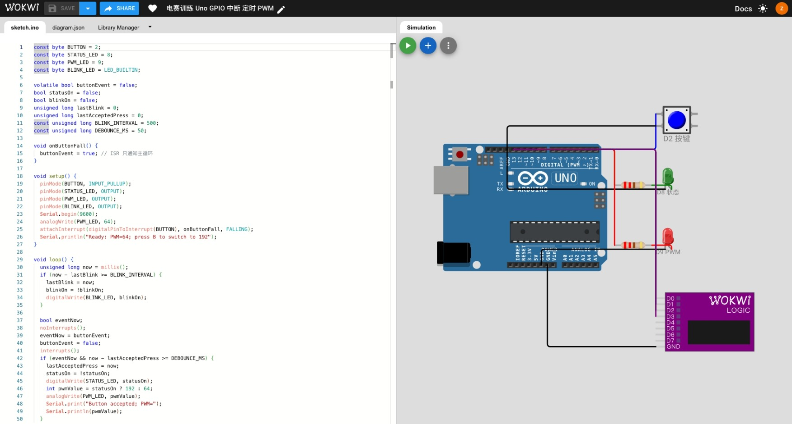
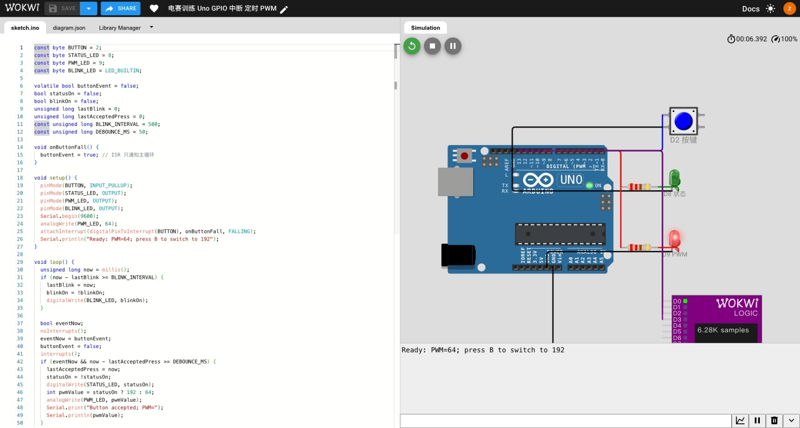
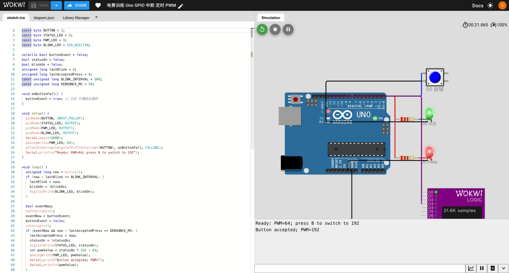
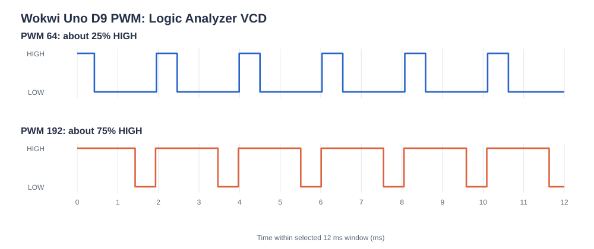

# Wokwi 浏览器操作与验证记录

> 2026 年 11 月 24 日在 Microsoft Edge 中实际操作。这个项目把 GPIO、外部中断、`millis()` 定时和 PWM 放在一起演示；学生仍应按[一周任务书](/tasks/wokwi-gpio-interrupt-pwm-week3/)分别保留三个阶段的作品。

**在线项目：**[电赛训练 Uno GPIO 中断 定时 PWM](https://wokwi.com/projects/481573723795052545)

## 浏览器操作顺序

1. 打开 [Wokwi](https://wokwi.com/)，选择 **Arduino (Uno, Mega, Nano)**，再新建 **Arduino Uno** 项目。
2. 在 `diagram.json` 中放入 Uno、D2 按键、D8 状态 LED、D9 PWM LED、两只 220 Ω 限流电阻和逻辑分析仪。按键接 D2 与 GND；逻辑分析仪的 D0 接 D9，D1 接 D2，D2 接 D8，D3 接板载 LED 对应的 D13，GND 接 Uno GND。
3. 在 `sketch.ino` 中设置 D2 为 `INPUT_PULLUP`，用下降沿中断设置事件标志；主循环处理按键事件、用 `millis()` 每约 500 ms 切换板载 LED，并在 D9 输出 PWM。
4. 点击绿色 **Start the simulation**。程序编译成功后，串口显示 `Ready: PWM=64; press B to switch to 192`，D9 的 LED 以较低亮度发光。
5. 点击蓝色 D2 按键（也可以按键盘 `B`）。D8 状态 LED 点亮，串口显示 `Button accepted; PWM=192`，D9 的 LED 更亮。再次点击按键，串口显示 `PWM=64`。
6. 点击 **Stop the simulation**。Wokwi 自动下载逻辑分析仪的 `wokwi-logic.vcd`。本次导出的文件已保存在[逻辑分析仪记录.vcd](/assets/images/wokwi/logic-demo.vcd)。

## 浏览器截图

### 1. 接线与程序

左侧是 `sketch.ino`，右侧是 Uno、按钮、两路 LED 和逻辑分析仪。外接 LED 的支路串有电阻。

### 2. 初始运行

仿真启动后，串口显示初始 PWM 设置值为 64；D8 状态 LED 尚未点亮。

### 3. 按键后

点击蓝色按键后，D8 状态 LED 点亮，串口显示 `PWM=192`。截图可直观看到 D9 LED 亮度变化；亮度观察应结合下方波形数据判断。

## 波形核对

从本次 VCD 文件中读取 D0（PWM）、D1（Button）、D2（State）、D3（Blink）。在稳定时段统计 D0 的高电平时间占比：

| 阶段 | `analogWrite()` 设置值 | VCD 高电平占比 |
| --- | ---: | ---: |
| 按键前 | 64 | 约 25.1% |
| 按键后 | 192 | 约 75.3% |

D3 的相邻翻转间隔约为 500 ms，与程序设定一致。下图截取按键前后各 12 ms 的 D0 波形；横轴只显示各时段的相对时间，不表示两个时段连续相邻。

本次演示验证了组合项目的运行流程。任务书中的轮询对照、按钮弹跳实验、`delay()` 对照，以及 0、128、255 等 PWM 设置值，仍需学生在各阶段独立完成并记录。
