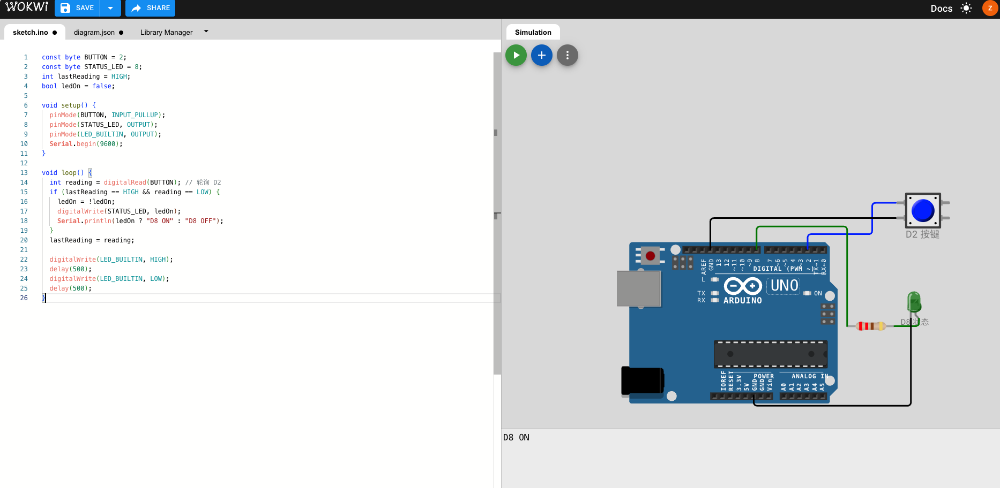
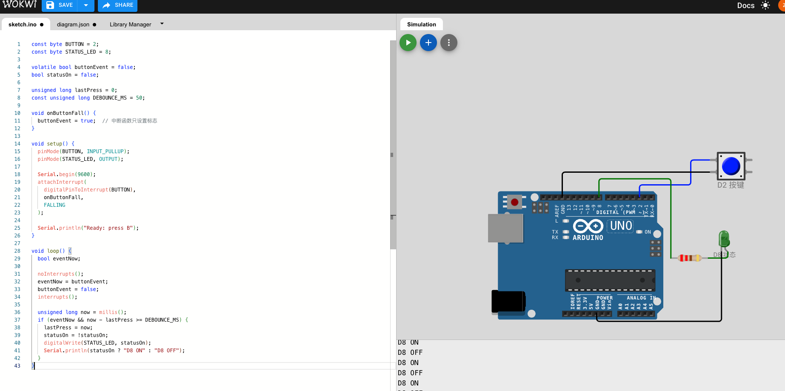
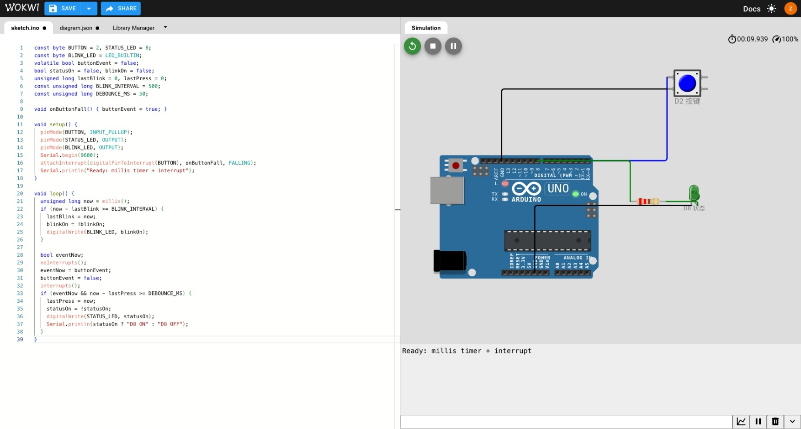
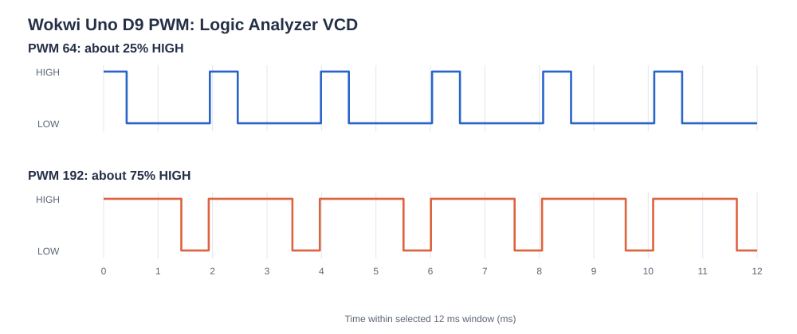

# Wokwi 单片机 GPIO、中断、定时与 PWM：基础概念讲解

> 配套任务：[《Wokwi 单片机 GPIO、中断、定时与 PWM 一周任务书》](/tasks/wokwi-gpio-interrupt-pwm-week3/)  
> 适用对象：已练习 C/C++、Ubuntu 和基本开发工具，尚未系统学习单片机的大一、大二学生  
> 阅读方法：先读第 1～2 节建立整体认识；做任务 A～E 时再读对应小节。本讲解帮助理解和排查，不替代独立完成任务。

## 1. 这一周究竟在学什么

前面的训练让程序在电脑上处理文件和图像；这周让程序与**引脚上的电平**打交道。按键产生输入，LED 是输出，时间决定何时执行动作，PWM 决定输出在高、低电平之间如何切换。

```text
人按下按钮
    ↓  D2 输入电平改变
Uno 程序发现事件 ──→ 更新 D8 状态 LED
    │
    ├─ 用 millis() 安排板载 LED 定时闪烁
    └─ 在 D9 输出 PWM ──→ 改变另一只 LED 的亮度
                              ↓
                         逻辑分析仪记录波形
```

这些概念以后可以迁移到真实开发板、传感器和电机控制，但**引脚编号、电压和外设功能不能直接照搬**。本周统一用 Wokwi 中的 Arduino Uno：其 D2 可作外部中断输入，D9 支持硬件 PWM，板载 `L` LED 接 D13。具体引脚以 [Wokwi Uno 参考页](https://docs.wokwi.com/parts/wokwi-arduino-uno)为准。

| 任务 | 先要弄懂的问题 | 留下的证据 |
| --- | --- | --- |
| A：GPIO 轮询 | 引脚如何输入/输出？程序怎样发现按键？ | 按键控制 D8 的运行现象、轮询代码 |
| B：外部中断 | 输入变化能否主动提醒程序？为何还要防抖？ | 中断标志、串口记录、弹跳观察 |
| C：`millis()` | 程序怎样“等时间”而不停止做其他事？ | 定时闪烁和按键同时工作的记录 |
| D：PWM | 设置值、亮度和高电平占比是什么关系？ | 两种设置值的 VCD 与同尺度波形 |
| E：复现 | 为什么只给截图不够？ | 源码、接线文件、README、Git 提交 |

## 2. Wokwi、Arduino 程序和真实单片机

### 2.1 三个位置不要混淆

**浏览器里的 Wokwi**提供编辑器、电路图和模拟运行环境。你在 Ubuntu、Windows 或其他电脑上打开浏览器，操作的是同一个在线平台。`sketch.ino` 是写给 Uno 的程序；仿真时，程序按单片机的引脚和时间行为运行，**不是由电脑上的 Python 直接控制这些引脚**。

Wokwi 项目里常见两个页签：

| 文件 | 它回答的问题 | 本周要保存什么 |
| --- | --- | --- |
| `sketch.ino` | 单片机收到输入后做什么？ | `setup()`、`loop()`、引脚操作和事件处理代码 |
| `diagram.json` | 板子和器件怎样连接？ | 器件、引脚、导线和器件属性 |

`sketch.ino` 使用 Arduino 风格的 **C++**。它延续你学过的变量、函数、`if` 和类型，但 Arduino 平台预先提供了 `pinMode()`、`digitalRead()`、`millis()` 等函数。`setup()` 在程序启动后执行一次，适合设置引脚和串口；`loop()` 随后反复执行。浏览器里点 **Start** 是编译并启动仿真，点 **Stop** 停止仿真；代码能编译，只说明语法和构建通过，接线及行为还需要观察。

### 2.2 为什么用仿真，哪些结论不能带到实物

仿真让每个人先有相同的 Uno、按钮、LED 和逻辑分析仪，便于把注意力放在事件、时间和波形上。Wokwi 支持 Uno 的 GPIO、外部中断和定时器等功能；它模拟的**按钮弹跳**可用于观察防抖问题。拿到实物后仍要重新检查实际电源、器件极性、限流电阻、引脚驱动能力、机械弹跳和测得的波形。仿真里的亮度与数据不能当作真实硬件的安全验收。参见 [Uno 仿真支持](https://docs.wokwi.com/parts/wokwi-arduino-uno)和[按钮说明](https://docs.wokwi.com/parts/wokwi-pushbutton)。

## 3. 任务 A：GPIO 输入、输出和轮询

### 3.1 GPIO 是什么

GPIO 是“通用输入输出引脚”。同一类引脚可按程序配置为**输入**或**输出**。本周 D2 用于读取按钮，D8 用于驱动状态 LED；D13 连接板载 LED。程序先配置用途，再读写电平：

```cpp
pinMode(2, INPUT_PULLUP);  // D2：输入，并启用内部上拉
pinMode(8, OUTPUT);        // D8：输出

int level = digitalRead(2); // 读取 D2 的 HIGH 或 LOW
digitalWrite(8, HIGH);      // 将 D8 输出为高电平
```

`HIGH` 和 `LOW` 是数字逻辑状态。它们不是“按钮按下”和“按钮松开”的固定代名词；具体含义由接线方式决定。`digitalWrite(8, HIGH)` 也不表示输出一个任意大小的数字“1 V”。

### 3.2 为什么按钮按下读到 `LOW`

按钮一侧接 D2，另一侧接 GND；D2 设置 `INPUT_PULLUP`。内部上拉电阻把**未按下**的输入维持在高电平，按下后按钮把 D2 接到 GND，输入变为低电平：

```text
松开：内部上拉 ──→ D2 读 HIGH     按下：D2 ── 按钮 ── GND，读 LOW
```

上拉的作用是防止悬空输入在未按下时随机跳变。Wokwi 的四脚按钮实际有两组触点：`1.l` 与 `1.r` 属于同一组，`2.l` 与 `2.r` 属于另一组；**按下才连接第 1 组和第 2 组**。接线时要选不同组的引脚，不能只凭画面上“四个脚看起来分开”来判断。参见 [Wokwi 按钮引脚说明](https://docs.wokwi.com/parts/wokwi-pushbutton)。

外接 LED 必须注意正负极，并在支路中串联限流电阻。板载 `L` LED 已经在 Uno 板上，使用 `LED_BUILTIN` 控制即可；本周 D8、D9 的外接 LED 仍需要各自的限流电阻。

### 3.3 轮询与“只在按下瞬间动作”

**轮询**就是程序每经过一次 `loop()`，主动调用 `digitalRead()` 查看按钮。若只是写 `if (reading == LOW)`，按住按钮期间可能每轮都执行一次动作。任务 A 要比较前后两次读数，只识别从 `HIGH` 变为 `LOW` 的那一刻：

| 上次读取 | 本次读取 | 可能发生的事 | 是否切换 D8 |
| --- | --- | --- | --- |
| HIGH | HIGH | 一直松开 | 否 |
| HIGH | LOW | 刚按下 | 是 |
| LOW | LOW | 仍按住 | 否 |
| LOW | HIGH | 松开 | 否 |

这叫**边沿检测**或**状态变化检测**。请注意，它只能避免“按住期间每轮都切换”；如果按钮触点弹跳，读数可能短时间出现多次 `HIGH → LOW`，仍可能误切换。



图中左侧的 `digitalRead()` 是主动检查，右侧 D8 LED 和串口 `D8 ON` 是一次观察结果。示例中的 `delay(500)` 会使检查输入的频率降低；短按可能被漏读，任务 C 会专门解决这个问题。

## 4. 任务 B：外部中断和按钮防抖

### 4.1 轮询与中断怎样发现同一件事

轮询像反复问“按钮按了没有”；**外部中断**像在指定引脚出现符合条件的电平变化时，硬件通知处理器暂时处理一件紧急小事。Uno 的 D2 可用于外部中断。对于上述上拉接法，按下时从高到低，因此使用 `FALLING`：

```cpp
attachInterrupt(digitalPinToInterrupt(2), onButtonFall, FALLING);
```

`digitalPinToInterrupt(2)` 把板卡的 D2 引脚换成相应的中断编号；`onButtonFall` 是自己定义的中断服务函数；`FALLING` 指高到低的边沿。不要假设所有单片机的任意引脚都支持同样的外部中断功能。参见 [Arduino `attachInterrupt()` 参考](https://docs.arduino.cc/language-reference/en/functions/external-interrupts/attachInterrupt/)。

```text
轮询：loop 运行到 digitalRead() → 发现输入变化 → 处理
中断：D2 出现下降沿 → 进入中断函数 → 留下事件标志 → loop 处理
```

“用中断”不等于整个功能会立即完成。如果 `loop()` 正在执行长时间 `delay()`，中断函数仍可被触发、设置标志，但 **D8 切换和串口打印若放在 `loop()` 中，仍要等主循环继续运行**。这正是 B 与 C 两个任务需要连起来理解的地方。[Arduino `delay()` 参考](https://docs.arduino.cc/language-reference/en/functions/time/delay/)说明，等待期间大部分主程序活动暂停，但中断等底层活动仍可发生。

### 4.2 为什么中断函数要短，`volatile` 做什么

中断函数通常只记录“发生了事”，把耗时的工作留给主循环：

```cpp
volatile bool buttonEvent = false;

void onButtonFall() {
  buttonEvent = true;
}
```

`volatile` 告诉编译器：这个变量可能在当前代码看不到的位置被改变，不应把读取它的结果当作永远不变。它**不会自动消除弹跳，也不能保证对任意复杂数据的访问都是原子的**。当主循环要“读取并清除”标志时，可在非常短的临界区内完成，避免刚读完、尚未清除时又来一次中断造成事件丢失。初学阶段先掌握原则：**中断里少做事，主循环里处理事**。

不要在中断函数中放 `delay()` 或大量 `Serial.print()`。Arduino 官方说明 `millis()` 依赖中断计时，进入中断函数后它不会像在主循环中那样持续递增；`delay()` 也不适合在其中等待。参见 [Arduino 中断函数注意事项](https://docs.arduino.cc/language-reference/en/functions/external-interrupts/attachInterrupt/)。

### 4.3 什么是弹跳，怎样判断防抖是否有效

机械按钮闭合或断开时，触点可能在很短时间里反复接触。程序看到的不是一次干净的 `HIGH → LOW`，而可能是一串变化。这叫**弹跳**。Wokwi 默认模拟弹跳；在按钮属性中把 `bounce` 设为 `0` 可暂时关闭，用于区分“基础逻辑错误”和“弹跳带来的问题”。参见 [Wokwi 按钮弹跳说明](https://docs.wokwi.com/parts/wokwi-pushbutton)。

一个常见的防抖思路是：检测到按下后，等待输入在短时间内保持稳定，再承认这次按下；只有确认稳定松开后，才允许下一次按下。另一种简化方法是记录上次有效按下时间，忽略间隔过短的事件。**固定一个时间间隔并不保证一定正确**：若仍出现重复切换，就要记录实际串口现象，再检查按钮配置、边沿选择、按下与松开处理、事件标志和时间条件。



这张演示截图里一次操作后先后出现 `D8 ON` 和 `D8 OFF`，**不能判定为防抖成功**。它是一个排查样本；应先用关闭弹跳的对照实验确认原因，再调整程序。右侧的蓝线把 D2 接到按键，绿线把 D8 接到 LED 支路，黑线回到 GND。

## 5. 任务 C：`millis()`、`delay()` 和非阻塞定时

### 5.1 两种“等 500 ms”为什么结果不同

`delay(500)` 让主程序在这一句等待约 500 ms。LED 可以因此闪烁，但主循环此时不再读取按钮。若代码连续执行两次 `delay(500)`，一次轮询之间可能相隔约 1 s，短按就容易错过。

`millis()` 返回程序启动以来经过的毫秒数。程序每轮读取当前时间，与上次执行的时间相减；没到间隔就继续做别的事：

```cpp
unsigned long lastBlink = 0; // 放在 loop() 外，保留上次执行时间

unsigned long now = millis();
if (now - lastBlink >= 500UL) {
  lastBlink = now;
  // 此处切换板载 LED 状态
}
// 无论这轮是否切换 LED，都继续处理按键等任务
```

这叫**非阻塞定时**：程序没有停在原地等待，而是反复检查“该做了吗”。它也不是让 Uno 同时执行两条主循环；若其他代码仍长时间阻塞，按键仍可能反应慢。Arduino 的 [Blink Without Delay 示例](https://docs.arduino.cc/built-in-examples/digital/BlinkWithoutDelay)正是用这个思路协调闪烁与按键读取。

### 5.2 为什么使用 `unsigned long` 和减法

时间值会持续增长，`int` 的范围不足以可靠保存 `millis()` 的结果。Uno 上常用 `unsigned long` 保存当前时间和上次时间。建议写 `now - lastBlink >= interval`，不要先计算一个遥远的绝对“截止时间”再直接比较。对固定宽度的无符号计数器，这种差值写法也便于正确处理计数回绕；本周只需会按此模式写、会解释“比较已经过去了多久”。

**500 ms 翻转一次**表示 LED 亮约 500 ms、灭约 500 ms；完整亮灭周期约 1 s。改为 200 ms 翻转一次后，完整周期约 400 ms。验收时要说清“翻转间隔”与“完整周期”不是同一个量。



截图中的 `now - lastBlink >= BLINK_INTERVAL` 是关键条件。静态图片不能证明周期是否正确，必须运行后观察或查看波形。

### 5.3 `millis()` 与硬件定时器是什么关系

Uno 的系统计时能力建立在芯片定时器上；Arduino 核心使用 **Timer0** 维护 `millis()` / `delay()` 所需的时间基准。本周调用 `millis()`，是在使用已经提供好的计时接口，**不是自己配置硬件定时器的寄存器**。提高任务会单独认识 Timer1 的计数、预分频、比较匹配和中断。D9/D10 的 PWM 与 Timer1 相关，随意改 Timer1 设置可能影响 D9 的 PWM，因此提高任务要另建项目。参见 [Arduino PWM 与定时器关系](https://docs.arduino.cc/tutorials/generic/secrets-of-arduino-pwm/)。

## 6. 任务 D：PWM、占空比和数字波形

### 6.1 PWM 不是“把 64 V 输出到 D9”

PWM 是**脉冲宽度调制**。引脚在高、低电平之间反复切换，每一轮重复称为一个周期。高电平持续时间占完整周期的比例叫**占空比**：

```text
占空比 = 高电平持续时间 ÷ 一个周期的总时间 × 100%
```

Uno 的 `analogWrite(9, value)` 对 D9 设置 PWM，常用 `value` 范围为 0～255。数值越大，通常高电平占比越大；**瞬间的引脚状态仍是数字高或低**，不是一个恒定的模拟电压。LED 因为快速亮灭而呈现不同的主观亮度，但亮度感受不一定与数字成正比。参见 [Arduino PWM 原理](https://docs.arduino.cc/tutorials/generic/secrets-of-arduino-pwm/)和[Uno PWM 引脚](https://docs.wokwi.com/parts/wokwi-arduino-uno)。

| `analogWrite(9, value)` | 可先怎样理解 | 波形上重点看什么 |
| ---: | --- | --- |
| 0 | 持续低电平，LED 灭 | 不必期待周期性脉冲 |
| 64 | 高电平占比较小，约四分之一 | 高电平段比低电平段短 |
| 128 | 高、低电平时间大致相近 | 两段长度接近 |
| 192 | 高电平占比较大，约四分之三 | 高电平段比低电平段长 |
| 255 | 持续高电平，LED 亮 | 不必期待周期性脉冲 |

表中的“四分之一”“四分之三”是入门近似理解，**实际比例以记录的波形为准**。教师演示的 VCD 中，64 与 192 对应的高电平占比分别约为 25.1% 和 75.3%。



### 6.2 逻辑分析仪与 VCD 各做什么

逻辑分析仪的数字通道记录“什么时候为高、什么时候为低”。把它的 **D0 接 Uno D9、GND 接 Uno GND**，就能记录 PWM 的变化。这里的“D0”是**分析仪通道名**，不是 Uno 的数字引脚 D0；这两个编号容易混淆。

Wokwi 浏览器仿真停止时，若电路中有逻辑分析仪，会下载 `wokwi-logic.vcd`。VCD 是保存**时间戳与电平变化**的文本格式；它不是截图，也不是测得的连续电压或电流。可在 PulseView 中用 **Import Value Change Dump data** 导入。若文件很大，按 [Wokwi 逻辑分析仪指南](https://docs.wokwi.com/guides/logic-analyzer)调整导入时的下采样设置，再放大到能看清若干完整周期。

比较 64 和 192 时，先把两张图调到**同一时间尺度**。在每张图中量出一个完整周期与其中的高电平时间，算高电平占比。只说“红灯更亮了”是现象；波形和占空比才是对 PWM 设置值的验证。教师的[演示 VCD](/assets/images/wokwi/logic-demo.vcd)和[波形图](/assets/images/wokwi/pwm-waveform.svg)可作读图练习，任务书仍要求自己导出和截图。

## 7. 任务 E：为什么要保存源码、接线和过程

**截图证明某一刻看到过什么**，却不包含全部代码、器件属性，也难以让别人修改后重新运行。一个可复现的阶段至少要有：

1. `sketch.ino`：程序逻辑；
2. `diagram.json`：器件和接线；
3. README：引脚表、运行方法、测试条件、结果与待补项；
4. Git 提交：从轮询到中断、再到定时与 PWM 的有效变化。

Wokwi 的 **SHARE** 链接方便同学打开项目，但在线链接不代替本地文件。做完一个阶段就保存该阶段文件；不要只留最后的综合版本，否则难以比较轮询、中断和非阻塞定时的差异。Git 提交可以帮助你找回上一阶段，README 帮助别人按相同步骤复现。

记录错误时，用“**现象 → 猜测 → 检查 → 结果**”四步。例如：“按一次 D8 变化两次 → 怀疑按钮弹跳 → 关闭 Wokwi 的弹跳并重复试验 → 记录变化，再检查程序防抖条件。”其中“怀疑”不是结论；检查之后才能写原因。


## 8. 容易混淆的六句话

| 常见说法 | 更准确的理解 |
| --- | --- |
| “按下按钮应该读到 HIGH。” | 本周 `INPUT_PULLUP` 接法是按下读 `LOW`。 |
| “用了中断，就不会漏按。” | 中断可先记下事件；主循环若长时间阻塞，实际处理仍可能延迟。 |
| “只检测 HIGH→LOW 就不用防抖。” | 弹跳也可能反复出现 HIGH→LOW。 |
| “`volatile` 就能保证按键只触发一次。” | `volatile` 解决编译器对共享变量的读取问题，不负责防抖。 |
| “`millis()` 就是我自己写了硬件定时器中断。” | 本周只调用现成计时接口；提高任务才接触 Timer1 配置。 |
| “PWM 的 192 表示 192 V。” | 192 是设置值；Uno D9 的数字高、低电平按不同时间比例交替。 |

## 9. 读完后自检

不看答案，试着用自己的话回答并写进 README：

1. 若 D2 按钮采用 `INPUT_PULLUP`，松开和按下分别读到什么？为什么？
2. “按住按钮时只切换一次 D8”和“按钮弹跳时也只切换一次 D8”是同一个要求吗？
3. 外部中断函数设置了标志，但 `loop()` 正在 `delay(500)`，D8 会在什么时候由主循环切换？
4. `millis()` 方案为何要保存“上次执行时间”？500 ms 翻转间隔对应多长的完整亮灭周期？
5. `analogWrite(9, 64)` 和 `analogWrite(9, 192)` 的波形，哪一个高电平占比更大？怎样用 VCD 证明？
6. 同学只发来一张运行截图，你还需要哪些文件才能修改并复现他的项目？

如果回答时只能说“程序就是这么写的”，请回到对应章节，画出输入、程序判断、输出和证据之间的关系。

## 10. 官方资料与本地示范

- [Wokwi：Arduino Uno 引脚、板载 LED 和仿真支持](https://docs.wokwi.com/parts/wokwi-arduino-uno)
- [Wokwi：按钮触点与弹跳设置](https://docs.wokwi.com/parts/wokwi-pushbutton)
- [Wokwi：逻辑分析仪、VCD 与 PulseView](https://docs.wokwi.com/guides/logic-analyzer)
- [Arduino：外部中断 `attachInterrupt()`](https://docs.arduino.cc/language-reference/en/functions/external-interrupts/attachInterrupt/)
- [Arduino：Blink Without Delay](https://docs.arduino.cc/built-in-examples/digital/BlinkWithoutDelay)
- [Arduino：PWM 原理和定时器关系](https://docs.arduino.cc/tutorials/generic/secrets-of-arduino-pwm/)
- [浏览器操作与验证记录](/workshop/wokwi-browser-demo/)
